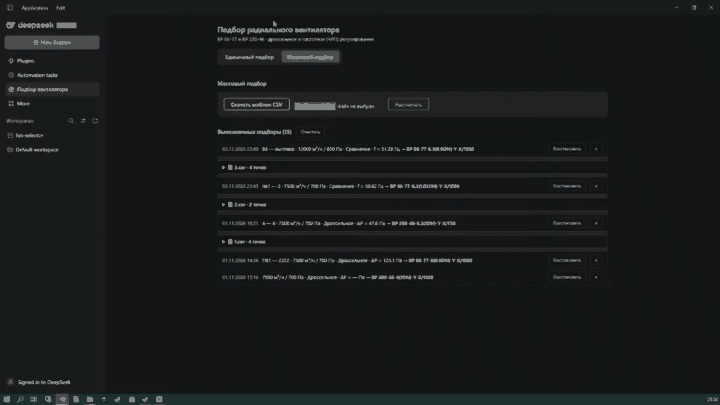
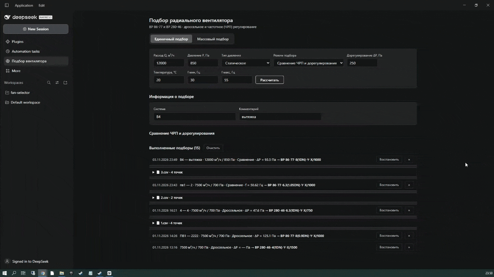
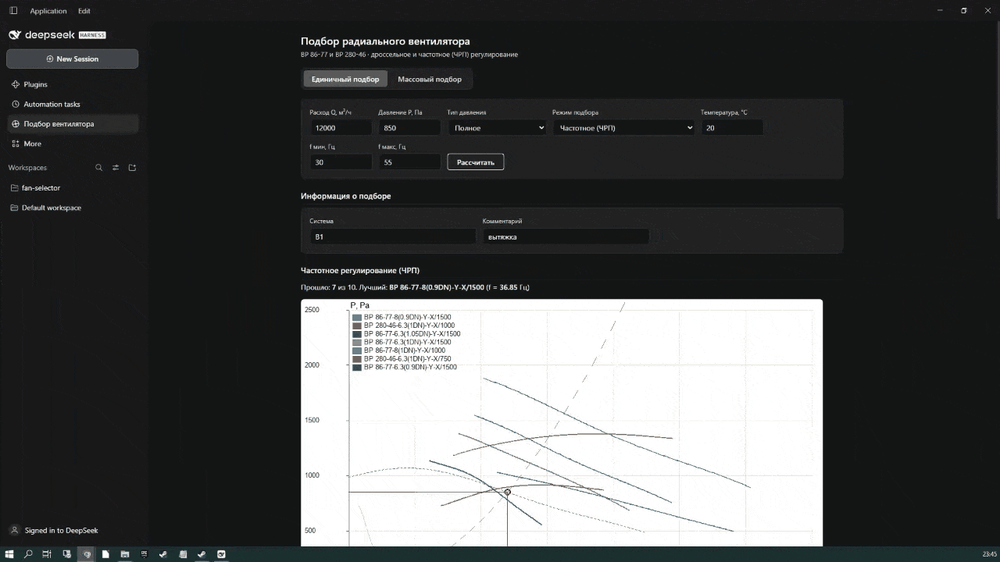
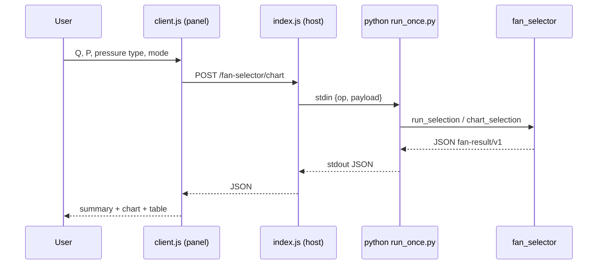

# fan-selector

[](LICENSE)
[](https://github.com/Ruskykot/radial-fan-selector-DSH/actions/workflows/ci.yml)
[](https://www.python.org/)
[](https://nodejs.org/)

[Русская версия](README.md) · **English**

Selection of radial fans of the **ВР 86-77** and **ВР 280-46** series by air flow
and pressure: motor selection, throttling (regulation reserve) and efficiency
calculation, dimensions and mass, characteristic charts, and bulk batch selection.

The project is packaged as a **DeepSeek Harness (DSH) plugin**: it plugs into DSH
with a single line in the profile, serves a REST API, registers the
`fan_selector_history` agent tool and a React panel “Fan selection”. The actual
calculation runs in a separate Python core `fan_selector` (JSON in → JSON out).

## Features

- Single selection by a working point (Q, P) ranked by regulation reserve.
- Three regulation modes: **throttle**, **frequency (VFD)** and **comparison**.
- Pressure type: full or static (with dynamic head recalculation).
- Motor selection with a safety factor and a real variable-frequency drive.
- P(Q) / η(Q) characteristic chart as a PNG right inside the panel.
- Bulk selection from CSV (template + parse preview) and durable selection history.
- MCP server and REST fallback for third-party clients (the MCP layer is experimental).

## Demo

**Throttle regulation**



**Frequency regulation (VFD)**



**Bulk selection from CSV**



## Repository layout

| Path | Purpose |
|---|---|
| `fan-selector-plugin/` | DSH bundle: host `index.js` + client `client.js` (+ `locale`, `cordis.patch.yml`, `core/`) |
| `fan-selector-plugin/core/` | calculation core inside the package: `run_once.py` + `select-radial-fan/` |
| `fan-selector-plugin/core/select-radial-fan/` | Python core `fan_selector`, `data/` references, MCP/REST adapters, React UI `web/` |
| `.dsh/skills/fan-selector/SKILL.md` | agent skill for DSH |
| `run-rest.py` | optional REST fallback of the core on a separate port |
| `LICENSE` | Apache-2.0 |

## Requirements

- DeepSeek Harness (DSH) `>= 0.2.0`;
- Python ≥ 3.11 with `numpy` and `Pillow` (required for calculations);
- for development: Node ≥ 20 + pnpm.

## Installation (users)

The plugin is installed as a **regular DSH package** — there is no need to clone
the repository or to install the core via `pip`: the Python core and the
reference data already ship inside the package.

### 1. Install Python 3.11+ and the libraries

```bash
pip install numpy pillow
```

Calculations run in a local Python process, so an interpreter is required on the
machine. If `python` is not in `PATH`, point to it with `FAN_SELECTOR_PYTHON`.

### 2. Add the plugin to the DSH profile

Through the DSH UI (**Profiles → install plugin → `@ruskykot/fan-selector`**) or
with the official CLI command:

```bash
dsh plugin --profile <profile> add @ruskykot/fan-selector
```

> If the `dsh` command is not found, add it to `PATH` (DSH settings → install
> command line) or call the full path
> `<DSH>/resources/runtime/cli/bin/dsh.cmd`.

The command adds the dependency to `~/.dsh/profiles/<profile>/package.json` and
runs `pnpm install`. Make sure the bundle `@ruskykot/fan-selector` is listed in
`dsh.profile.bundles` — DSH loads only the bundles listed there:

```jsonc
{
  "dependencies": {
    "@ruskykot/fan-selector": "^1.0.0"
  },
  "dsh": { "profile": { "bundles": ["@ruskykot/fan-selector"] } }
}
```

### 3. Restart DSH

After the restart the “Fan selection” panel appears, and the agent gets the
`fan_selector_history` tool and the `fan-selector` skill.

If Python or the libraries are missing, the panel shows a clear error with the
install command, and the API returns the `ENV` code.

## Development

```bash
git clone https://github.com/Ruskykot/radial-fan-selector-DSH.git
cd radial-fan-selector-DSH

# core as a regular package (or pip install -e ...)
pip install ./fan-selector-plugin/core/select-radial-fan

# link the local plugin checkout into the DSH profile
dsh plugin --profile <profile> add "link:<repo_path>/fan-selector-plugin"
```

Development requirements: Node ≥ 20 + pnpm (for building `web/`), Python 3.11+.

Core and adapter tests:

```bash
cd fan-selector-plugin/core/select-radial-fan
pip install -r requirements.txt -r requirements-mcp.txt
python tests/test_golden.py
python tests/test_golden_fixture.py
python tests/test_mcp.py
python tests/test_mcp_registration.py
python tests/test_rest.py
```

- UI (optional standalone React widget, not used by the plugin):
  `cd web && pnpm install && pnpm dev` (build check — `pnpm build`).
- MCP server: `python mcp_stdio.py streamable-http` (experimental: the API and the
  launcher may change, support is not guaranteed).
- REST fallback: `python run-rest.py 8100`.

## Plugin behaviour

The plugin is a **DSH bundle** made of two halves.

### Host half (`fan-selector-plugin/index.js`)

Exports `inject = ['tools', 'webServer', 'subprocess']` and `apply(ctx)`.
On every DSH start the plugin:

1. registers HTTP routes on the built-in DSH web server;
2. registers the agent tool `fan_selector_history`.

| Method & path | Purpose |
|---|---|
| `POST /fan-selector/select` | selection (throttle mode) |
| `POST /fan-selector/chart` | selection + PNG chart |
| `POST /fan-selector/compare` | throttle vs. VFD comparison |
| `POST /fan-selector/catalog` | catalog cards |
| `POST /fan-selector/batch/parse` | CSV parsing without calculation (preview) |
| `POST /fan-selector/batch` | bulk selection from CSV |
| `GET /fan-selector/template.csv` | CSV template |
| `GET/POST/DELETE /fan-selector/history` | read / append / clear history |
| `POST /fan-selector/history/batch` | batch history write |

**Key idea:** there is no long-running process. For every request the host spawns
`python run_once.py`, sends `{op, payload}` over stdin and reads the JSON from
stdout through DSH's built-in `subprocess` service. The plugin therefore survives
DSH restarts without any external service.

### Client half (`fan-selector-plugin/client.js`)

Loaded through `window.__ModuleLoader__.load`; it injects the React panel into the
`sidebar.panellist` slot (sidebar icon) and the `main` slot (the panel itself).
The panel has two tabs: **Single selection** and **Bulk selection**.

### Request lifecycle



### History

Selection history is stored in a JSON file (`~/.fan-selector-history.json` by
default) and survives restarts. The cap is 5000 entries. Pinning a fan in the
table saves the point to history; an entry can be restored or deleted.

## Operating modes

| Mode | `regulation_mode` | What it does | Sorting |
|---|---|---|---|
| Throttle | `THROTTLE` | selection by the catalog curve, throttling reserve | by Δreg (smaller is better) |
| Frequency (VFD) | `VFD` | selection by similarity laws + frequency drive | by required frequency `f`, Hz |
| Comparison | `COMPARE` | both calculations for one point + a shared chart | — |
| Bulk | CSV file | many points in one run | by file rows |

### 1. Throttle regulation (THROTTLE)

The core fits the catalog curve `P(Q)` (least-squares polynomial) and evaluates
the pressure at the working point. A fan passes if:
`q_min ≤ Q ≤ q_max`, `P_fan(Q) ≥ p_req`, `Δreg = P_fan − p_req ≤ d_reg_max`,
efficiency data exists and a suitable motor is found. Sorting is by the smallest
regulation reserve (more energy-efficient).

### 2. Frequency regulation (VFD)

- network coefficient `k = p_req / q_req²`;
- intersection of the nominal curve `P_nom(Q)` and the network parabola `k·Q²` → `Q₀`;
- relative frequency `f = q_req / Q₀`; `f_hz = f · 50`, `n_rpm = f · max_n`;
- range check `freq_min_hz ≤ f_hz ≤ freq_max_hz`;
- efficiency by similarity (shifted along flow), shaft power with safety factor;
- the motor is selected at nominal speed, then a VFD by `p_kw` / `i_nom_a`.

### 3. Comparison (COMPARE)

One request runs two calculations (`THROTTLE` and `VFD`) for the same point and
returns both blocks — `throttle` and `vfd` — plus a shared comparison chart.

### 4. Bulk selection (CSV)

The “Bulk selection” tab: download a CSV template, upload a file, see a parse
preview (row count, per-row errors) and run the batch calculation.

Template columns:
`System;Comment;Flow Q, m³/h;Pressure P, Pa;Pressure type;Mode;Throttle ΔP, Pa;Temperature, °C;f min, Hz;f max, Hz`.
The delimiter is `;` or `,`; encoding is UTF-8 (BOM allowed) or CP1251.
The maximum is 5000 rows per file.

### Pressure type

- `FULL` — full pressure (default);
- `STATIC` — static pressure: the curve is recalculated point by point as
  `P_stat = P_full − ρv²/2`, and power is computed from the restored full pressure.

## Calculation core

The core is pure Python without I/O: `dict → dict`. It lives in
`fan-selector-plugin/core/select-radial-fan/fan_selector/`.

### Layers and modules

```
fan_selector/
├── select.py         ADAPTER: dict → dict, the single entry point
├── repositories.py   JSON → domain models (+ lru_cache)
├── config.py         config.json load/validation (fail-fast)
├── selector.py       ORCHESTRATOR: filters, iteration, sorting
├── core.py           CALCULATION: throttle mode
├── vfd.py            CALCULATION: frequency regulation (VFD)
├── chart.py          PNG chart rendering
└── models.py         domain models (dataclass)
```

### Reference data (`data/`, not code)

| File | Content |
|---|---|
| `fans.json` | fan cards: series, speed, motor bounds, noise |
| `impellers.json` | impellers: `P(Q)` points, `η(Q)` points, outlet area |
| `motors.json` | motors: model, kW, rpm |
| `vfd.json` | variable-frequency drives (power, current, voltage) |
| `catalog.json` | dimensions/mass, noise by speed, executions |
| `config.json` | air ρ, polynomial degree, safety table, validation bounds |
| `golden.json` | executable contract — reference answers |

### Throttle selection algorithm

1. Drop fans that do not cover the flow range (`q_min..q_max`).
2. Fit the `P(Q)` characteristic with a least-squares polynomial (degree ≤ `poly_degree`).
3. Check `P_fan(Q) ≥ p_req` and `Δreg ≤ d_reg_max`.
4. Compute efficiency `η(Q)` (polynomial of degree `min(poly_degree, 3)`).
5. Shaft power `N = (Q/3600)·P_full / η`, multiplied by the safety factor.
6. Select a motor: `n_rpm == max_n`, power within the card bounds,
   `n_kw ≥ N_calc`, the smallest sufficient one.
7. Estimate casing noise and sort by `Δreg`.

Details — [`fan-selector-plugin/core/select-radial-fan/docs/CALCULATION.md`](fan-selector-plugin/core/select-radial-fan/docs/CALCULATION.md).

### Result contract (`fan-result/v1`)

```jsonc
{
  "schema": "fan-result/v1",
  "query": { "q_req": 7500, "p_req": 700, "pressure_type": "FULL" },
  "summary": {
    "total": 10, "passed": 9,
    "best_model": "ВР 280-46-6.3(1DN)-Y-X/750", "best_d_reg_pa": 47.56
  },
  "results": [
    { "model": "...", "status": "OK", "passed": true, "d_reg_pa": 47.56,
      "eta_req": 0.6292, "n_shaft_with_margin_w": 2846.61,
      "motor": { "name": "160S8", "n_kw": 7.5, "n_rpm": 750 },
      "noise_body_dba": 0, "curve": { "q_points": [], "p_points": [] } }
  ]
}
```

Errors are returned as `{"error": {"code", "message"}}` — exceptions are never
thrown outward.

### Golden checks

`fan-selector-plugin/core/select-radial-fan/tests/test_golden.py` pins the reference numbers: any change
of the calculation result breaks the test.

## Plugin environment variables

| Variable | Purpose | Default |
|---|---|---|
| `FAN_SELECTOR_RUNNER` | path to `run_once.py` | `<plugin>/core/run_once.py` |
| `FAN_SELECTOR_PYTHON` | Python interpreter (with `numpy` and `Pillow`) | `python` / `python3` |
| `FAN_SELECTOR_CORE` | path to the `fan_selector` package | `<plugin>/core/select-radial-fan` |
| `FAN_SELECTOR_HISTORY` | selection history file | `~/.fan-selector-history.json` |

## Contributing

- [CONTRIBUTING.md](CONTRIBUTING.md) — how to propose a change.
- [CODE_OF_CONDUCT.md](CODE_OF_CONDUCT.md) — community rules.
- [SECURITY.md](SECURITY.md) — how to report a vulnerability.
- [CHANGELOG.md](CHANGELOG.md) — version history.
- Questions and bugs — via [Issues](https://github.com/Ruskykot/radial-fan-selector-DSH/issues).

## License

Apache-2.0 — see [`LICENSE`](LICENSE). The data in `data/*.json` is described in
[`NOTICE`](NOTICE).
