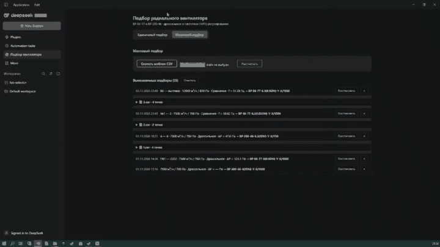
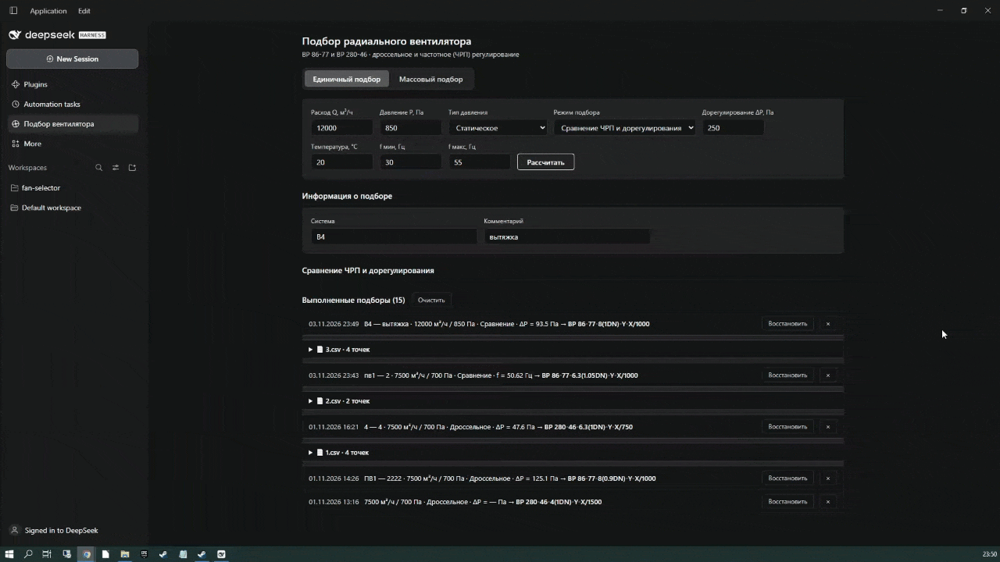
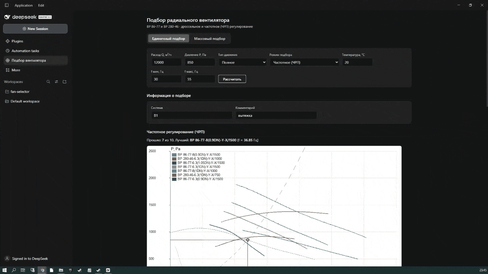
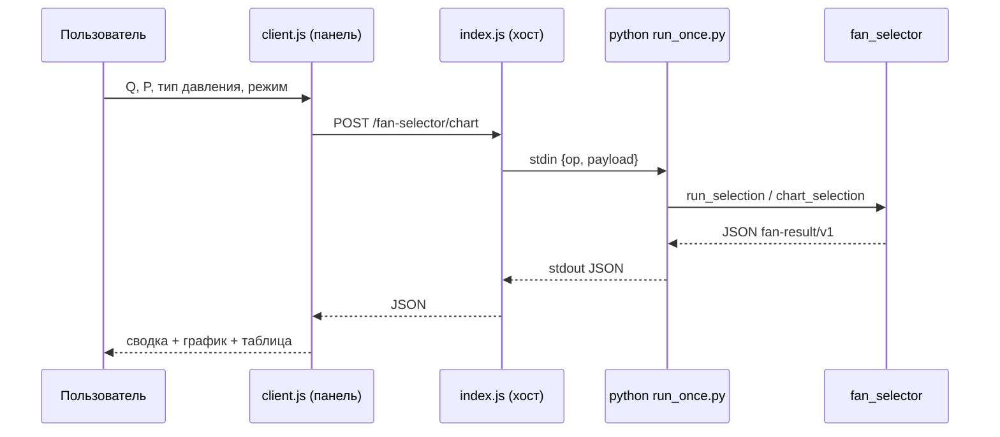

# fan-selector

[](LICENSE)
[](https://github.com/Ruskykot/radial-fan-selector-DSH/actions/workflows/ci.yml)
[](https://www.npmjs.com/package/@rusky_kot/fan-selector)
[](https://www.python.org/)
[](https://nodejs.org/)

**Русский** · [English](README.en.md)

Подбор радиальных вентиляторов серий **ВР 86-77** и **ВР 280-46** по расходу и
давлению: подбор электродвигателя, расчёт дорегулирования и КПД, массо-габаритные
характеристики, график характеристик и массовый пакетный подбор.

Проект оформлен как **плагин DeepSeek Harness (DSH)**: встраивается в DSH строкой
в профиле, раздаёт REST-API, регистрирует инструмент `fan_selector_history` и
React-панель «Подбор вентилятора». Расчёт выполняет отдельное Python-ядро
`fan_selector` (JSON на входе → JSON на выходе).

## Возможности

- Единичный подбор по точке (Q, P) с ранжированием по дорегулированию.
- Три режима регулирования: **дроссельное**, **частотное (ЧРП)** и **сравнение**.
- Тип давления: полное или статическое (с пересчётом динамического напора).
- Подбор электродвигателя с коэффициентом запаса и реального частотного преобразователя.
- График характеристик P(Q) / η(Q) в виде PNG прямо в панели.
- Массовый подбор из CSV (шаблон + превью разбора) и durable-история подборов.
- MCP-сервер и REST-фолбэк для сторонних клиентов (MCP-слой — экспериментальный).

## Демо

**Дроссельное регулирование (дорегулирование)**



**Частотное регулирование (ЧРП + дорегулирование)**



**Массовый подбор из CSV**



## Состав репозитория

| Каталог/файл | Назначение |
|---|---|
| `fan-selector-plugin/` | DSH-бандл: хост `index.js` + клиент `client.js` (+ `locale`, `cordis.patch.yml`, `core/`) |
| `fan-selector-plugin/core/` | расчётное ядро внутри пакета: `run_once.py` + `select-radial-fan/` |
| `fan-selector-plugin/core/select-radial-fan/` | Python-ядро `fan_selector`, справочники `data/`, MCP/REST-адаптеры, React-UI `web/` |
| `.dsh/skills/fan-selector/SKILL.md` | навык для агента DSH |
| `run-rest.py` | REST-фолбэк ядра на отдельном порту (опционально) |
| `LICENSE` | Apache-2.0 |

## Требования

- DeepSeek Harness (DSH) `>= 0.2.0`;
- Python ≥ 3.11 с `numpy` и `Pillow` (обязательно для расчёта);
- для разработки: Node ≥ 20.19 + pnpm.

## Установка (пользователям)

Плагин ставится как **обычный пакет DSH** — клонировать репозиторий и
устанавливать ядро через `pip` не нужно: Python-ядро и справочники уже внутри
пакета.

### 1. Поставить Python 3.11+ и библиотеки

```bash
pip install numpy pillow
```

Расчёт выполняет локальный Python-процесс, поэтому интерпретатор нужен на машине.
Если `python` не в `PATH`, укажите его переменной `FAN_SELECTOR_PYTHON`.

### 2. Установить плагин в профиль DSH

Через интерфейс DSH (**Профили → установка плагина → `@rusky_kot/fan-selector`**)
или официальной CLI-командой:

```bash
dsh plugin --profile <профиль> add @rusky_kot/fan-selector
```

> Если команда `dsh` не найдена в `PATH`, добавьте её (настройки DSH → установка
> командной строки) или вызывайте полный путь
> `<DSH>/resources/runtime/cli/bin/dsh.cmd`.

Команда добавляет зависимость в `~/.dsh/profiles/<профиль>/package.json` и
выполняет `pnpm install`. Убедитесь, что бандл `@rusky_kot/fan-selector` указан в
`dsh.profile.bundles` — DSH загружает только перечисленные бандлы:

```jsonc
{
  "dependencies": {
    "@rusky_kot/fan-selector": "^1.0.0"
  },
  "dsh": { "profile": { "bundles": ["@rusky_kot/fan-selector"] } }
}
```

### 3. Перезапустить DSH

После перезапуска появится панель «Подбор вентилятора», а у агента — инструмент
`fan_selector_history` и навык `fan-selector`.

Если Python или библиотеки не найдены, панель покажет понятную ошибку с
командой установки, а API вернёт код `ENV`.

## Разработка

```bash
git clone https://github.com/Ruskykot/radial-fan-selector-DSH.git
cd radial-fan-selector-DSH

# ядро как обычный пакет (или pip install -e ...)
pip install ./fan-selector-plugin/core/select-radial-fan

# подключить локальный чекаут плагина в профиль DSH
dsh plugin --profile <профиль> add "link:<путь_к_репозиторию>/fan-selector-plugin"
```

Требования для разработки: Node ≥ 20.19 + pnpm (для сборки `web/`), Python 3.11+.

Тесты расчётного ядра и адаптеров:

```bash
cd fan-selector-plugin/core/select-radial-fan
pip install -r requirements.txt -r requirements-mcp.txt
python tests/test_golden.py
python tests/test_golden_fixture.py
python tests/test_mcp.py
python tests/test_mcp_registration.py
python tests/test_rest.py
```

- UI (опциональный самостоятельный React-виджет, плагином не используется):
  `cd web && pnpm install && pnpm dev` (проверка сборки — `pnpm build`).
- MCP-сервер: `python mcp_stdio.py streamable-http` (экспериментально: API и
  запуск могут меняться, поддержка не гарантирована).
- REST-фолбэк: `python run-rest.py 8100`.

## Логика работы плагина

Плагин — **бандл DSH** из двух половин.

### Хост-половина (`fan-selector-plugin/index.js`)

Экспортирует `inject = ['tools', 'webServer', 'subprocess']` и `apply(ctx)`.
На каждом старте DSH плагин:

1. регистрирует HTTP-маршруты на встроенном web-сервере DSH;
2. регистрирует инструмент агента `fan_selector_history`.

| Метод и путь | Назначение |
|---|---|
| `POST /fan-selector/select` | подбор (дроссельный режим) |
| `POST /fan-selector/chart` | подбор + PNG-график |
| `POST /fan-selector/compare` | сравнение дроссельного и ЧРП |
| `POST /fan-selector/catalog` | каталожные карточки |
| `POST /fan-selector/batch/parse` | разбор CSV без расчёта (превью) |
| `POST /fan-selector/batch` | массовый подбор по CSV |
| `GET /fan-selector/template.csv` | шаблон CSV |
| `GET/POST/DELETE /fan-selector/history` | чтение / добавление / очистка истории |
| `POST /fan-selector/history/batch` | пакетная запись истории |

**Ключевая идея:** постоянного процесса нет. На каждый запрос хост запускает
`python run_once.py`, передаёт `{op, payload}` через stdin и забирает JSON со
stdout через штатный сервис `subprocess` DSH. Поэтому плагин переживает
перезапуски DSH без внешних сервисов.

### Клиент-половина (`fan-selector-plugin/client.js`)

Грузится через `window.__ModuleLoader__.load` и вставляет React-панель в слоты
`sidebar.panellist` (иконка в боковой панели) и `main` (сама панель). В панели
две вкладки: **Единичный подбор** и **Массовый подбор**.

### Цикл запроса



### История

История подборов хранится в JSON-файле (`~/.fan-selector-history.json` по
умолчанию) и не теряется между перезапусками. Лимит — 5000 записей. Фиксация
вентилятора в таблице сохраняет точку в историю; запись можно восстановить или
удалить.

## Режимы работы

| Режим | `regulation_mode` | Что делает | Сортировка |
|---|---|---|---|
| Дроссельное | `THROTTLE` | подбор по каталожной кривой, дорегулирование дросселем | по Δрег (меньше — лучше) |
| Частотное (ЧРП) | `VFD` | подбор по законам подобия + частотный преобразователь | по требуемой частоте `f`, Гц |
| Сравнение | `COMPARE` | оба расчёта для одной точки + общий график | — |
| Массовый | CSV-файл | много точек за один прогон | по строкам файла |

### 1. Дроссельное регулирование (THROTTLE)

Ядро строит аппроксимацию каталожной кривой `P(Q)` (МНК-полином) и находит
давление в рабочей точке. Вентилятор проходит, если:
`q_min ≤ Q ≤ q_max`, `P_вент(Q) ≥ p_req`, `Δрег = P_вент − p_req ≤ d_reg_max`,
есть данные КПД и подходящий двигатель. Сортировка — по минимальному
дорегулированию (энергетически выгоднее).

### 2. Частотное регулирование (ЧРП / VFD)

- коэффициент сети `k = p_req / q_req²`;
- точка пересечения номинальной кривой `P_nom(Q)` и параболы сети `k·Q²` → `Q₀`;
- относительная частота `f = q_req / Q₀`; `f_hz = f · 50`, `n_rpm = f · max_n`;
- проверка диапазона `freq_min_hz ≤ f_hz ≤ freq_max_hz`;
- КПД по подобию (смещение точки по расходу), мощность на валу с запасом;
- двигатель подбирается по номинальной частоте, затем ЧРП по `p_kw` / `i_nom_a`.

### 3. Сравнение (COMPARE)

Один запрос — два расчёта (`THROTTLE` и `VFD`) для одной точки плюс общий
график сравнения. Ответ содержит оба блока — `throttle` и `vfd`.

### 4. Массовый подбор (CSV)

Вкладка «Массовый подбор»: скачать шаблон CSV, загрузить файл, увидеть превью
разбора (число строк, ошибки по строкам) и запустить пакетный расчёт.

Колонки шаблона:
`Система;Комментарий;Расход Q, м³/ч;Давление P, Па;Тип давления;Режим;Дорегулирование ΔP, Па;Температура, °C;f мин, Гц;f макс, Гц`.
Разделитель — `;` или `,`; кодировка — UTF-8 (BOM допускается) или CP1251.
Максимум строк на файл — 5000.

### Тип давления

- `FULL` — полное давление (по умолчанию);
- `STATIC` — статическое: кривая пересчитывается по точкам
  `P_стат = P_полн − ρv²/2`, а мощность считается по восстановленному полному
  давлению.

## Расчётное ядро

Ядро — чистые функции Python без I/O: `dict → dict`. Лежит в
`fan-selector-plugin/core/select-radial-fan/fan_selector/`.

### Слои и модули

```
fan_selector/
├── select.py         АДАПТЕР: dict → dict, единственная точка входа
├── repositories.py   загрузка JSON → доменные модели (+ lru_cache)
├── config.py         загрузка/валидация config.json (fail-fast)
├── selector.py       ОРКЕСТРАТОР: фильтры, перебор, сортировка
├── core.py           РАСЧЁТ: дроссельный режим
├── vfd.py            РАСЧЁТ: частотное регулирование (ЧРП)
├── chart.py          построение PNG-графиков
└── models.py         доменные модели (dataclass)
```

### Справочники (`data/`, не код)

| Файл | Содержимое |
|---|---|
| `fans.json` | карточки вентиляторов: серия, обороты, границы двигателя, шум |
| `impellers.json` | рабочие колёса: точки `P(Q)`, точки `η(Q)`, площадь выхода |
| `motors.json` | электродвигатели: марка, кВт, об/мин |
| `vfd.json` | частотные преобразователи (мощность, ток, напряжение) |
| `catalog.json` | массо-габариты, шум по оборотам, исполнения |
| `config.json` | ρ воздуха, степень полинома, таблица запасов, границы валидации |
| `golden.json` | исполняемый контракт — эталонные ответы |

### Алгоритм дроссельного подбора

1. Отбросить вентиляторы, не покрывающие диапазон расхода (`q_min..q_max`).
2. Построить МНК-полином характеристики `P(Q)` (степень ≤ `poly_degree`).
3. Проверить `P_вент(Q) ≥ p_req` и `Δрег ≤ d_reg_max`.
4. Найти КПД `η(Q)` (полином степени `min(poly_degree, 3)`).
5. Мощность на валу `N = (Q/3600)·P_полн / η`, умножить на коэффициент запаса.
6. Подобрать двигатель: `n_rpm == max_n`, мощность в границах карточки,
   `n_kw ≥ N_расч`, минимальная достаточная.
7. Оценить шум корпуса и отсортировать по `Δрег`.

Подробности — [`fan-selector-plugin/core/select-radial-fan/docs/CALCULATION.md`](fan-selector-plugin/core/select-radial-fan/docs/CALCULATION.md).

### Контракт результата (`fan-result/v1`)

```jsonc
{
  "schema": "fan-result/v1",
  "query": { "q_req": 7500, "p_req": 700, "pressure_type": "FULL" },
  "summary": {
    "total": 10, "passed": 9,
    "best_model": "ВР 280-46-6.3(1DN)-Y-X/750", "best_d_reg_pa": 47.56
  },
  "results": [
    { "model": "...", "status": "OK", "passed": true, "d_reg_pa": 47.56,
      "eta_req": 0.6292, "n_shaft_with_margin_w": 2846.61,
      "motor": { "name": "160S8", "n_kw": 7.5, "n_rpm": 750 },
      "noise_body_dba": 0, "curve": { "q_points": [], "p_points": [] } }
  ]
}
```

Ошибки возвращаются как `{"error": {"code", "message"}}` — исключения наружу не
выбрасываются.

### Проверка (golden)

`fan-selector-plugin/core/select-radial-fan/tests/test_golden.py` фиксирует эталонные числа: любое
изменение результата расчёта ломает тест.

## Переменные окружения плагина

| Переменная | Назначение | По умолчанию |
|---|---|---|
| `FAN_SELECTOR_RUNNER` | путь к `run_once.py` | `<плагин>/core/run_once.py` |
| `FAN_SELECTOR_PYTHON` | интерпретатор Python (с `numpy` и `Pillow`) | `python` / `python3` |
| `FAN_SELECTOR_CORE` | путь к пакету `fan_selector` | `<плагин>/core/select-radial-fan` |
| `FAN_SELECTOR_HISTORY` | файл истории подборов | `~/.fan-selector-history.json` |

## Участие

- [CONTRIBUTING.md](CONTRIBUTING.md) — как предложить изменение.
- [CODE_OF_CONDUCT.md](CODE_OF_CONDUCT.md) — правила общения.
- [SECURITY.md](SECURITY.md) — как сообщить об уязвимости.
- [CHANGELOG.md](CHANGELOG.md) — история версий.
- Вопросы и ошибки — через [Issues](https://github.com/Ruskykot/radial-fan-selector-DSH/issues).

## Лицензия

Apache-2.0 — см. [`LICENSE`](LICENSE). Данные из справочников `data/*.json`
описаны в [`NOTICE`](NOTICE).
