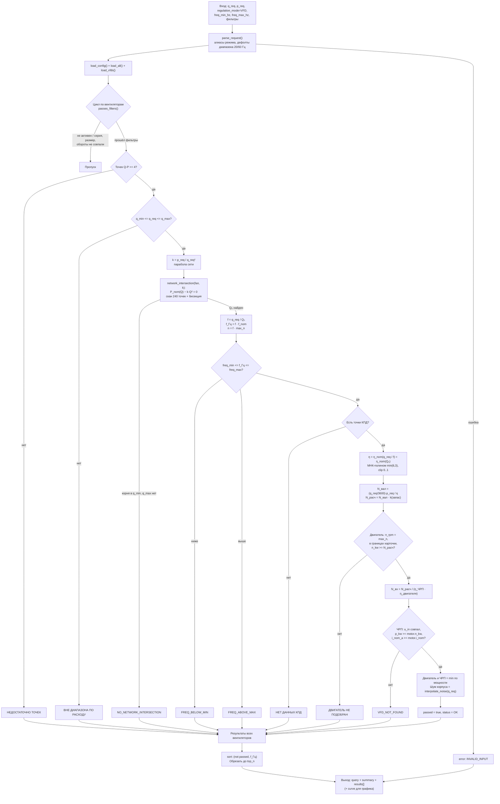

# Расчёт с частотным регулированием (ЧРП / VFD)

Документ описывает **как именно считается подбор в режиме частотного
регулирования** (`regulation_mode = VFD`): от рабочей точки (расход + давление)
и диапазона частоты до пары «электродвигатель — частотный преобразователь».

Это дополнение к [CALCULATION.md](CALCULATION.md): там — дроссельный режим
(`THROTTLE`), здесь — режим ЧРП. Ядро дроссельного расчёта при этом **не
модифицируется**: частотный расчёт живёт в отдельном модуле `vfd.py`.

> Все числа в примерах получены прогоном текущего ядра — их можно воспроизвести
> командой из раздела [«Проверка расчёта»](#10-проверка-расчёта). Golden-фикстура
> (`data/golden.json`) пока фиксирует только дроссельные точки, поэтому таблица
> п. 7 — это снимок текущего ядра, а не регрессионный тест (см. п. 9).

---

## 1. Что делает режим VFD

В дроссельном режиме вентилятор всегда работает на **номинальной** частоте
карточки (`max_n`), а избыток давления «придушивается» заслонкой — это
дорегулирование `Δрег`. В режиме ЧРП заслонки нет: **частота вращения
подбирается так, чтобы характеристика вентилятора прошла точно через заданную
точку**.

Программа отвечает на вопрос:

> «Заказчику нужен расход *Q* м³/ч при давлении *P* Па. Какой вентилятор
> **ВР 86-77** / **ВР 280-46** выйдет в эту точку при частоте в диапазоне
> *[f_min, f_max]* Гц, какой нужен двигатель и какой частотный преобразователь?»

Для каждого вентилятора из справочника она:

1. отбрасывает те, что не покрывают требуемый расход;
2. строит параболу сети `P = k·Q²` через заданную точку;
3. ищет `Q₀` — пересечение номинальной кривой вентилятора с этой параболой;
4. вычисляет **относительную частоту** `f = Q_треб / Q₀`, частоту в Гц и обороты;
5. проверяет, что частота попала в заданный диапазон;
6. пересчитывает **КПД** по законам подобия (точка КПД смещается по расходу);
7. считает **мощность на валу**, умножает на коэффициент запаса;
8. подбирает **электродвигатель** (по номинальной частоте карточки);
9. считает **потребляемую мощность** с учётом КПД ЧРП и двигателя;
10. подбирает **частотный преобразователь** по параметрам двигателя;
11. при наличии данных — оценивает шум корпуса.

Всё, что проходит все проверки, сортируется по требуемой частоте (меньше —
первым) и обрезается до `top_n`.

Главное отличие от дроссельного режима: **`Δрег` не считается** (вентилятор не
«передавливает» — он выходит в точку), поэтому в выдаче `d_reg_pa = 0.0`, а
сортировка идёт не по `Δрег`, а по `f_hz`.

---

## 2. Карта модулей

```
select-radial-fan/
├── data/
│   ├── vfd.json               справочник ЧРП: модель, кВт, ток, напряжение, фазы
│   ├── motors.json            электродвигатели (сюда же — i_nom, если известен)
│   └── config.json            блок "vfd": f_nom_hz, η_ЧРП, η_двигателя
│
├── fan_selector/
│   ├── vfd.py                 РАСЧЁТ ЧРП — чистые функции:
│   │                          network_intersection(), select_vfd(), compute_vfd_one()
│   ├── selector.py            select_fans_vfd() — перебор, фильтры, сортировка
│   ├── select.py              ветвление режима и JSON-сериализация VFD-полей
│   ├── core.py                переиспользуется как есть: fit_curve, safety_factor,
│   │                          _select_motor, _interpolate_noise
│   ├── models.py              RegulationMode, Vfd, поля VFD в FanResult
│   ├── repositories.py        load_vfds() (lru_cache; нет файла → пустой список)
│   └── chart.py               приведённая кривая P_f(Q) для режима VFD
│
├── schema/result.schema.json  поля f_hz, n_rpm, q0, n_in_w, vfd
└── data/golden.json           эталонные ответы (пока только дроссельные точки)
```

**Ключевое разделение:**

| Слой | Где | Что меняется при расширении |
|------|-----|-----------------------------|
| Справочник ЧРП | `data/vfd.json` | **Правится свободно** — код не трогаем |
| Константы ЧРП | `data/config.json` → блок `vfd` | Правятся без кода |
| Расчёт ЧРП | `vfd.py` | Только при изменении **метода** (законы подобия, поиск точки) |
| Контракт снаружи | `select.py`, `schema/` | При изменении **полей** входа/выхода |

Дроссельное ядро (`core.py`) в режиме ЧРП **не модифицируется** — оно
переиспользуется как библиотека (`fit_curve`, `safety_factor`, `_select_motor`,
`_interpolate_noise`).

---

## 3. Схема логики расчёта



### Порядок проверок не случаен

Проверки идут **от дешёвых к дорогим** и образуют «воронку». Отчёт всегда
показывает *первую* сработавшую причину отказа:

| # | Проверка | Статус отказа | Что означает |
|---|----------|---------------|--------------|
| 1 | `len(q_points) >= 4` | `НЕДОСТАТОЧНО ТОЧЕК` | Кривую нельзя построить |
| 2 | `q_min ≤ Q ≤ q_max` | `ВНЕ ДИАПАЗОНА ПО РАСХОДУ` | Рабочая зона карточки не покрывает расход |
| 3 | есть пересечение с сетью | `NO_NETWORK_INTERSECTION` | В паспортном диапазоне расхода кривая нигде не пересекает параболу сети |
| 4 | `freq_min ≤ f_Гц ≤ freq_max` | `FREQ_BELOW_MIN` / `FREQ_ABOVE_MAX` | Требуемая частота вне заданного диапазона |
| 5 | есть `eff_points` | `НЕТ ДАННЫХ КПД` | Невозможно посчитать мощность |
| 6 | найден двигатель | `ДВИГАТЕЛЬ НЕ ПОДОБРАН` | Нет двигателя нужной мощности в границах карточки |
| 7 | найден ЧРП | `VFD_NOT_FOUND` | Нет преобразователя под параметры двигателя |

Статусы 3 и 7 — намеренно латиницей (как в ТЗ и в `models.py`), остальные
русские, как и в дроссельном режиме.

Отдельно от статусов: результаты, отброшенные **фильтрами** (`series`, `sizes`,
`rpms`, `active = false`), вообще не попадают в выдачу — они не считаются и
строки результата не создают.

---

## 4. Математика расчёта

### 4.1. Сеть и рабочая точка

Пользователь задаёт точку `(Q_треб, P_треб)`. Считается, что вентилятор работает
на **квадратичную сеть**, проходящую через эту точку:

```
P_сети(Q) = k · Q²,   где k = P_треб / Q_треб²
```

Коэффициент `k` — единственное, что «знает» расчёт о сети. Сопротивление сети
отдельно не задаётся: любая точка `(Q, P)` однозначно определяет параболу.

**Давление в режиме ЧРП трактуется как полное.** Параметр `pressure_type`
(`FULL` / `STATIC`) в VFD-расчёте **не используется** — он принимается и
эхом возвращается в `query`, но на числа не влияет (см. п. 9).
Поэтому `P_треб` в формуле выше — полное давление, которое должен создать
вентилятор, чтобы выйти в точку.

*Где:* `vfd.py::compute_vfd_one` (шаг «коэффициент сети»)

### 4.2. Точка Q₀ — пересечение номинальной кривой с сетью

Дальше нужно найти расход `Q₀`, при котором **номинальная** (паспортная) кривая
вентилятора пересекает параболу сети:

```
P_nom(Q₀) = k · Q₀²
```

Смысл: при частоте `f` кривая масштабируется по законам подобия; точка, в
которую вентилятор попадёт при частоте `f`, — это точка паспортной кривой с
расходом `Q₀ = Q_треб / f`. Значит, `Q₀` — это и есть точка пересечения
паспортной кривой с сетью, а искомая частота — `f = Q_треб / Q₀`.

Аналитического решения нет: `P_nom(Q)` — МНК-полином степени 6 (см.
[CALCULATION.md](CALCULATION.md), п. 4.1), поэтому уравнение
`g(Q) = P_nom(Q) − k·Q² = 0` решается численно:

```python
def network_intersection(fan, k, cfg):
    poly = fit_curve(fan.q_points, fan.p_points, cfg.poly_degree)
    g = lambda q: poly(q) - k * q * q
    # 1) скан 240 точек на [q_min, q_max], ищем первую смену знака;
    # 2) бисекция в найденном интервале (~80 делений пополам).
```

Детали, важные для понимания отказов:

* поиск идёт **только в паспортном диапазоне** `[q_min, q_max]` колеса;
* берётся **первое** пересечение слева (если полином «гуляет» и пересечений
  несколько, результат — самое левое);
* если знак `g(Q)` на всём диапазоне не меняется — пересечения нет
  (`NO_NETWORK_INTERSECTION`). Это бывает, когда кривая целиком лежит **выше**
  параболы сети: требуемая точка достигается замедлением, но `Q₀` оказался бы
  за `q_max` — вне проверенной характеристики.

**Пример отказа.** `Q = 7500 м³/ч, P = 700 Па`, вентилятор
`ВР 86-77-4(0.9DN)-Y-X/3000` (диапазон 3117…7850 м³/ч). Кривая на всём диапазоне
выше сети: `P_nom` падает с 1870 до 899 Па, а парабола сети растёт с 121 до
767 Па — `g(Q) > 0` везде. Пересечение было бы при `Q ≈ 8130 м³/ч`, уже за
`q_max`, поэтому карточка получает `NO_NETWORK_INTERSECTION`.

*Где:* `vfd.py::network_intersection`

### 4.3. Законы подобия: частота и обороты

Вентилятор, работающий на частоте `f` относительно номинальной, создаёт:

```
Q_f     = f · Q_nom
P_f     = f² · P_nom          (по полному давлению)
N_f     = f³ · N_nom
```

Отсюда требуемая относительная частота:

```
f = Q_треб / Q₀
```

и производные величины:

```
f_Гц = f · f_nom            (f_nom = 50 Гц из config.json)
n    = f · max_n            (max_n — номинальные обороты карточки: 750/1000/1500/3000)
```

`f < 1` — вентилятор замедляется (обычный случай: паспортная кривая при
`Q_треб` даёт давление выше требуемого); `f > 1` — **перекрут**, работа выше
номинальной частоты.

**Проверка диапазона.** Требуемая частота должна попасть в
`[freq_min_hz, freq_max_hz]`, иначе — отказ `FREQ_BELOW_MIN` /
`FREQ_ABOVE_MAX`. Границы задаёт пользователь; по умолчанию 20…60 Гц
(см. п. 6.1). Прочностной или резонансной проверки при перекруте нет — верхняя
граница диапазона и есть вся защита (см. п. 9).

**Перекрут на практике.** Точка ниже/правее паспортной кривой требует `f > 1`.
Например, `Q = 4000 м³/ч, P = 1200 Па` при диапазоне 20…60 Гц даёт для
`ВР 86-77-3.15(1DN)-Y-X/3000` частоту **53.02 Гц** (3181 об/мин), а для
`ВР 280-46-3.15(1DN)-Y-X/1500` — **58.3 Гц** (1749 об/мин). Оба варианта
проходят, пока частота не выходит за `freq_max_hz`.

*Где:* `vfd.py::compute_vfd_one` (шаги «частота/обороты» и «диапазон частоты») ·
*Параметр:* `config.json::vfd.f_nom_hz`

### 4.4. КПД по подобию

КПД — функция расхода, а не оборотов: при изменении частоты точка КПД
**смещается по расходу** вместе с кривой. Поэтому КПД в рабочей точке берётся
из паспортной кривой `η_nom(Q)` в точке `Q₀`:

```
η_f(Q_треб) = η_nom(Q_треб / f) = η_nom(Q₀)
```

Реализация — та же, что в дроссельном режиме: МНК-полином по точкам
`q_eff` / `eff_points`, степень `min(poly_degree, 3)` (куполообразная кривая
КПД плохо аппроксимируется высокой степенью), затем `clip(η, 0, 1)`.

```python
eta_poly = fit_curve(fan.q_eff, fan.eff_points, min(cfg.poly_degree, 3))
eta_f = clip(eta_poly(q_req / f), 0.0, 1.0)
```

Если точек КПД нет — статус `НЕТ ДАННЫХ КПД`, дальше вентилятор не считается.
Зависимости КПД от диаметра/оборотов/числа Re в модели нет: кривая одна на
колесо (см. п. 9).

*Где:* `vfd.py::compute_vfd_one` (шаг «КПД подобием»)

### 4.5. Мощности: на валу, с запасом, потребляемая

Мощность на валу:

```
N_вал = (Q_треб / 3600) · P_треб / max(η, 0.01)     [Вт]
```

Затем — коэффициент запаса по той же таблице, что и в дроссельном режиме
(ступени по `N_вал`, [CALCULATION.md](CALCULATION.md), п. 4.5):

```
N_расч = N_вал · k(N_вал)
```

Именно `N_расч` лежит в выдаче в поле `n_shaft_with_margin_w` (и дублируется в
`n_shaft_kw`); отдельного поля «N_вал без запаса» нет.

Потребляемая из сети мощность:

```
N_вх = N_расч / (η_ЧРП · η_дв)
```

где `η_ЧРП = 0.97`, `η_дв = 0.85` (КПД двигателя при частичной нагрузке,
принят константой). Комбинированный КПД — `0.8245`.

> **Важно:** `N_вх` считается от мощности **с запасом**, а не от «чистого»
> `N_вал`. Это осознанное решение: выдача показывает потребление комплекта
> «вентилятор + двигатель + ЧРП» с учётом того, что двигатель выбран с запасом.
> Трактуйте `n_in_w` как оценку сверху, а не как паспортное потребление.

*Где:* `vfd.py::compute_vfd_one` (шаги «мощность на валу» и «потребляемая
мощность») · *Параметры:* `config.json::vfd.eta_vfd`,
`config.json::vfd.eta_motor_part_load`, `config.json::safety_table`

### 4.6. Подбор электродвигателя

Двигатель ищется по трём одновременным условиям (та же логика, что в
дроссельном режиме):

| Условие | Смысл |
|---------|-------|
| `motor.n_rpm == fan.max_n` | Частота вращения двигателя = **номинальной** частоте карточки |
| `fan.min_n_kw ≤ motor.n_kw ≤ fan.max_n_kw` | Мощность допустима для этой карточки |
| `motor.n_kw ≥ N_расч` | Мощности хватает с учётом запаса |

Среди подходящих берётся **минимальный по `n_kw`**.

Обратите внимание: двигатель подбирается на **номинальную** частоту карточки
(`max_n`), а не на фактические обороты `n = f · max_n`. Это корректно для схемы
«двигатель + внешний ЧРП»: преобразователь питает двигатель, и номинальная
частота двигателя соответствует номиналу вентилятора. Например, у победителя
эталонного расчёта карточка на 3000 об/мин, фактические обороты — 2079 об/мин,
а двигатель — `112M2` (3000 об/мин, 7.5 кВт).

Если подходящего двигателя нет — `ДВИГАТЕЛЬ НЕ ПОДОБРАН`.

*Где:* `core.py::_select_motor` (переиспользуется) —
`vfd.py::compute_vfd_one` (шаг «двигатель»)

### 4.7. Подбор частотного преобразователя

ЧРП подбирается **после** двигателя, по его параметрам, из `data/vfd.json`:

| Условие | Смысл |
|---------|-------|
| `vfd.u_in == fan.voltage` | Напряжение/сеть преобразователя = напряжению карточки вентилятора |
| `vfd.p_kw ≥ motor.n_kw` | Мощность преобразователя не меньше мощности двигателя |
| `vfd.i_nom_a ≥ motor.i_nom` | Выходной ток не меньше номинального тока двигателя (**если ток известен**) |

Среди подходящих берётся **минимальный по `p_kw`** — «самый дешёвый
достаточный». Если подходящего нет — `VFD_NOT_FOUND`.

Практические замечания по текущим справочникам:

* в `motors.json` поле `i_nom` **не заполнено ни у одного** из 55 двигателей,
  поэтому третье условие сейчас всегда истинно и отбор фактически идёт только по
  мощности. Как только токи появятся в справочнике, критерий заработает без
  правки кода;
* у всех карточек вентиляторов `voltage = "380/50"` и у всех 18 ЧРП
  `u_in = "380/50"`, поэтому первое условие тоже всегда истинно; сети 220/400 В
  появятся только вместе с данными;
* перегрузочная способность, тип нагрузки, торможение, фильтры и т. п. не
  проверяются — это этап 2 (см. п. 9).

*Где:* `vfd.py::select_vfd`

### 4.8. Шум корпуса

Оценка шума — та же, что в дроссельном режиме: дискретная выборка из массива
`noise_body` по положению расхода между крайними точками кривой (не
интерполяция). Считается по `Q_треб`, в конце расчёта — только для вариантов,
дошедших до подбора ЧРП.

*Где:* `core.py::_interpolate_noise` (переиспользуется) ·
*Поле карточки:* `fans.json::noise_body`

---

## 5. Порядок проверок и статусы

См. таблицу в [п. 3](#порядок-проверок-не-случаен). Значения статусов в JSON:

| Статус | Когда выставляется | Заполнены ли `f_hz`, `n_rpm`, `q0` |
|--------|--------------------|--------------------------------------|
| `OK` | всё сошлось | да |
| `НЕДОСТАТОЧНО ТОЧЕК` | `< 4` точек кривой | нет |
| `ВНЕ ДИАПАЗОНА ПО РАСХОДУ` | `Q_треб` вне `q_min..q_max` | нет |
| `NO_NETWORK_INTERSECTION` | нет корня `g(Q)=0` в `q_min..q_max` | нет |
| `FREQ_BELOW_MIN` / `FREQ_ABOVE_MAX` | частота вне диапазона | нет |
| `НЕТ ДАННЫХ КПД` | нет `eff_points` | да |
| `ДВИГАТЕЛЬ НЕ ПОДОБРАН` | нет двигателя | да |
| `VFD_NOT_FOUND` | нет ЧРП | да |

Поля `f_hz`/`n_rpm`/`q0` присваиваются в результате **после** проверки
диапазона частоты, поэтому у ранних отказов они `null`. Это удобно для
диагностики: если `f_hz` заполнена, значит отказ произошёл уже на двигателе или
ЧРП.

---

## 6. Вход, выход и параметры

### 6.1. Вход (`run_selection`)

| Поле | Тип | Обязат. | По умолч. | Описание |
|------|-----|---------|-----------|----------|
| `q_req` | number | **да** | — | Требуемый расход, м³/ч |
| `p_req` | number | **да** | — | Требуемое давление, Па (трактуется как полное) |
| `regulation_mode` | string | нет | `THROTTLE` | Включает режим; принимаются `VFD`, `vfd`, `frequency`, `частотное` |
| `freq_min_hz` | number | нет | 20.0 | Нижняя граница частоты, Гц |
| `freq_max_hz` | number | нет | 60.0 | Верхняя граница частоты, Гц |
| `series` | string[] | нет | `[]` | Фильтр по сериям; пусто = все |
| `sizes` | number[] | нет | `[]` | Фильтр по диаметру колеса, м; пусто = все |
| `rpms` | integer[] | нет | `[]` | Фильтр по номинальным оборотам карточки; пусто = все |
| `pressure_type` | string | нет | `FULL` | **В VFD не влияет**: принимается и эхом возвращается |
| `d_reg_max` | number | нет | 1500.0 | **В VFD не влияет** (дорегулирования нет) |
| `t_air` | number | нет | 20.0 | **На расчёт не влияет** (плотность фиксирована) |

Дефолты `freq_min_hz`/`freq_max_hz` задаются **в коде** (`select.parse_request`,
20/60 Гц) и продублированы в `config.json` как `vfd.f_min_hz_default` /
`vfd.f_max_hz_default`; последние сейчас не читаются (см. п. 8.2).

Пример запроса:

```json
{"q_req": 7500, "p_req": 700, "regulation_mode": "VFD",
 "freq_min_hz": 30, "freq_max_hz": 60}
```

### 6.2. Выход

Схема та же, `fan-result/v1` ([result.schema.json](../schema/result.schema.json)),
плюс VFD-поля в каждом результате:

```
{ schema: "fan-result/v1",
  query:   { q_req, p_req, pressure_type, d_reg_max, t_air,
             series, sizes, rpms,
             regulation_mode: "VFD", freq_min_hz, freq_max_hz },
  summary: { total, passed, best_model, best_d_reg_pa },
  results: [ { model, series, size, dn, d_over_dn, max_n, dims, mass,
               executions, noise_by_rpm,
               status, passed,
               d_reg_pa: 0.0, eta_req, n_shaft_with_margin_w, n_shaft_kw,
               motor: {name, n_kw, n_rpm, i_nom} | null,
               noise_body_dba, q_work, p_work,
               regulation_mode: "VFD",
               f_hz, n_rpm, q0, n_in_w,
               vfd: {model, p_kw, i_nom_a, u_in, phase} | null,
               curve: {q_points, p_points, q_eff, eff_points, q_min, q_max} } ] }
```

Особенности VFD-выдачи:

* `d_reg_pa` всегда `0.0` — дорегулирование в этом режиме не считается;
* `q_work = q_req`, `p_work = p_req` (в дроссельном режиме `p_work` — давление
  вентилятора в точке);
* `f_hz`, `n_rpm`, `q0` — округлены до 2 знаков; `n_in_w` — до 2;
* `curve` присутствует всегда: по нему харнесс/UI строит график, включая
  приведённую кривую при частоте `f` (см. п. 6.4);
* `summary.total` — **число строк после обрезки до `top_n`** (в справочнике 66
  вентиляторов, в выдаче — до 10), а не общее число вентиляторов;
* `summary.best_d_reg_pa` в режиме VFD всегда `0.0` (поле переиспользуется из
  дроссельного контракта и здесь не пересчитывается). Ориентир для «лучшего» —
  `f_hz` первого прошедшего результата: сортировка идёт по возрастанию частоты.

### 6.3. Параметры расчёта (`config.json`, блок `vfd`)

```json
"vfd": {
  "f_nom_hz": 50.0,
  "f_min_hz_default": 20.0,
  "f_max_hz_default": 60.0,
  "eta_vfd": 0.97,
  "eta_motor_part_load": 0.85
}
```

| Параметр | Значение | Влияние |
|----------|----------|---------|
| `f_nom_hz` | 50 Гц | Масштаб `f_Гц = f · f_nom`; график приведённой кривой использует те же 50 Гц |
| `f_min_hz_default` | 20 Гц | **Зарезервирован**: дефолт фактически задан в `select.parse_request` |
| `f_max_hz_default` | 60 Гц | **Зарезервирован**: дефолт фактически задан в `select.parse_request` |
| `eta_vfd` | 0.97 | КПД преобразователя в `N_вх` |
| `eta_motor_part_load` | 0.85 | КПД двигателя при частичной нагрузке в `N_вх` |

Блок `vfd` **опциональный**: при его отсутствии `config.py` подставляет эти же
значения по умолчанию (обратная совместимость со старым `config.json`).

### 6.4. Справочник ЧРП (`data/vfd.json`)

Плоский массив записей:

```json
{ "model": "ПЧВ-102-7К5-В", "p_kw": 7.5, "i_nom_a": 15.4,
  "u_in": "380/50", "phase": "3ф" }
```

| Поле | Тип | Обязат. | Смысл |
|------|-----|---------|-------|
| `model` | string | **да** | Номенклатура (каталожное обозначение) |
| `p_kw` | number | **да** | Номинальная мощность, кВт |
| `i_nom_a` | number | **да** | Номинальный выходной ток, А |
| `u_in` | string | нет | Входное напряжение/сеть; по умолчанию `"380/50"` |
| `phase` | string | нет | Число фаз; по умолчанию `"3ф"` |

Сейчас в справочнике **18 записей** от 0.37 до 90 кВт (стандартная лестница:
0.37, 0.75, 1.5, 2.2, 3.0, 4.0, 5.5, 7.5, 11, 15, 18.5, 22, 30, 37, 45, 55,
75, 90), все `380/50`, `3ф`. Файла нет → `load_vfds()` вернёт пустой список, и
все варианты получат `VFD_NOT_FOUND` (без исключений).

**График.** В режиме VFD `chart_selection` дополнительно рисует приведённую
кривую лучшего варианта: `Q_прив = f·Q`, `P_прив = f²·P_nom(Q)`, пунктиром.
В режиме сравнения (`run_comparison`, схема `fan-compare/v1`) для одного
вентилятора рисуются две кривые — номинальная (дроссель) и приведённая (ЧРП).

---

## 7. Эталонный расчёт (проверяемый пример)

Вход:

```json
{"q_req": 7500, "p_req": 700, "pressure_type": "FULL",
 "regulation_mode": "VFD", "freq_min_hz": 30, "freq_max_hz": 60}
```

Проверено прогоном ядра — в выдаче 10 вариантов (`top_n`), **9 прошли**:

```
{'total': 10, 'passed': 9,
 'best_model': 'ВР 86-77-4(1.05DN)-Y-X/3000', 'best_d_reg_pa': 0.0}
```

| Вентилятор | max_n | f, Гц | n, об/мин | Q₀, м³/ч | η | N_расч, Вт | N_вх, Вт | Двигатель | ЧРП |
|---|---|---|---|---|---|---|---|---|---|
| **ВР 86-77-4(1.05DN)-Y-X/3000** | 3000 | **34.66** | 2079.31 | 10820.9 | 0.7558 | 2315.38 | 2808.22 | 112M2 · 7.5 кВт | **ПЧВ-102-7К5-В · 7.5 кВт** |
| ВР 86-77-4(1DN)-Y-X/3000 | 3000 | 37.59 | 2255.51 | 9975.56 | 0.7332 | 2386.92 | 2894.99 | 100L2 · 5.5 кВт | ПЧВ-102-5К5-В · 5.5 кВт |
| ВР 280-46-5(1DN)-Y-X/1000 | 1000 | 39.79 | 795.73 | 9425.3 | 0.732 | 2390.84 | 2899.75 | 112MB6 · 4.0 кВт | ПЧВ-102-4К0-В · 4.0 кВт |
| ВР 86-77-6.3(0.9DN)-Y-X/1500 | 1500 | 41.45 | 1243.64 | 9046.01 | 0.8303 | 2107.63 | 2556.25 | 132S4 · 7.5 кВт | ПЧВ-102-7К5-В · 7.5 кВт |
| ВР 86-77-8(0.9DN)-Y-X/1000 | 1000 | 46.58 | 931.61 | 8050.55 | 0.7904 | 2214.03 | 2685.3 | 112MB6 · 4.0 кВт | ПЧВ-102-4К0-В · 4.0 кВт |
| ВР 86-77-5(1.05DN)-Y-X/1500 | 1500 | 46.66 | 1399.81 | 8036.79 | 0.8292 | 2110.43 | 2559.65 | 100S4 · 3.0 кВт | ПЧВ-101-3К0-В · 3.0 кВт |
| ВР 280-46-6.3(1DN)-Y-X/750 | 750 | 47.98 | 719.74 | 7815.35 | 0.6446 | 2601.92 | 3155.76 | 160S8 · 7.5 кВт | ПЧВ-102-7К5-В · 7.5 кВт |
| ВР 86-77-5(1DN)-Y-X/1500 | 1500 | 50.3 | 1509.05 | 7455.02 | 0.8217 | 2129.65 | 2582.96 | 90L4 · 2.2 кВт | ПЧВ-101-2К2-В · 2.2 кВт |
| ВР 86-77-6.3(1.05DN)-Y-X/1000 | 1000 | 50.62 | 1012.33 | 7408.64 | 0.7857 | 2227.32 | 2701.42 | 112MA6 · 3.0 кВт | ПЧВ-101-3К0-В · 3.0 кВт |
| ВР 86-77-6.3(1DN)-Y-X/1000 | 1000 | 53.85 | 1076.9 | 6964.42 | 0.8082 | 2165.23 | — | — | — · `ДВИГАТЕЛЬ НЕ ПОДОБРАН` |

Разбор результата:

* **Победитель** `ВР 86-77-4(1.05DN)-Y-X/3000`: карточка на 3000 об/мин,
  замедленная до **34.66 Гц** (≈2079 об/мин), выходит в точку из паспортной
  кривой при `Q₀ = 10820.9 м³/ч` — дорегулирования нет вовсе.
* Сортировка по частоте: первыми идут самые «медленные» варианты, т. е.
  карточки с высокой номинальной частотой, которые приходится сильно замедлять.
* Последняя строка — `ВР 86-77-6.3(1DN)-Y-X/1000`: по аэродинамике и частоте
  (53.85 Гц) вариант проходит, но `N_расч = 2165.23 Вт` выходит за границы
  двигателя карточки (1.1…1.5 кВт) — `ДВИГАТЕЛЬ НЕ ПОДОБРАН`.
* Сводное `best_d_reg_pa = 0.0` — не ошибка: в режиме VFD дорегулирование не
  считается, поле контракта сохраняется для совместимости (см. п. 6.2).

### 7.1. Сравнение с дроссельным режимом на той же точке

| Показатель | Дроссельное (`THROTTLE`) | Частотное (`VFD`) |
|---|---|---|
| Лучший вентилятор | ВР 280-46-6.3(1DN)-Y-X/750 | ВР 86-77-4(1.05DN)-Y-X/3000 |
| Режим работы | номинал 750 об/мин + дроссель | 34.66 Гц, 2079 об/мин |
| Дорегулирование / частота | `Δрег = 47.56 Па` | в точке, без дорегулирования |
| КПД в точке | 0.6292 | 0.7558 |
| Мощность на валу с запасом | 2846.61 Вт | 2315.38 Вт |
| Двигатель | 160S8 · 7.5 кВт | 112M2 · 7.5 кВт |
| Частотный преобразователь | — | ПЧВ-102-7К5-В · 7.5 кВт |
| Потребление из сети (оценка) | — | 2808.22 Вт |

Выводы:

* режим ЧРП выбирает **другой вентилятор**: карточка на 3000 об/мин,
  замедленная до 34.66 Гц, выходит в точку без дросселя и с меньшей мощностью
  на валу (2315 против 2847 Вт, ≈ −19 %);
* КПД в точке у победителя ЧРП выше (0.7558 против 0.6292), но это **не**
  «прирост КПД того же вентилятора» — сравниваются разные карточки, и в
  дроссельном режиме точка лежит выше паспортной кривой (есть `Δрег`);
* мощность двигателя в обоих случаях 7.5 кВт, но у ЧРП появляется ещё
  преобразователь — стоимость комплекта выше, зато эксплуатационная мощность
  ниже. Денежного критерия выбора в модели нет (см. п. 9).

### 7.2. Другие проверенные случаи

| Сценарий | Запрос | Результат |
|----------|--------|-----------|
| Перекрут `f > 1` | `Q=4000, P=1200, 20…60 Гц` | 5 прошедших; `ВР 86-77-3.15(1DN)-Y-X/3000` — 53.02 Гц, 3181 об/мин; `ВР 280-46-3.15(1DN)-Y-X/1500` — 58.3 Гц, 1749 об/мин |
| Верхняя граница частоты | `Q=7000, P=1600, 20…60 Гц` | 3 прошедших; `ВР 86-77-5(0.9DN)-Y-X/1500` требует `f > 60 Гц` → `FREQ_ABOVE_MAX` |
| Нижняя граница частоты | `Q=7500, P=700, 48…50 Гц` | 0 прошедших: у части подходящих `f_Гц < 48` (победитель «обычного» расчёта требует 34.66 Гц), у остальных — `> 50`; в окно 48…50 не попал никто |
| Пересечение вне диапазона | `Q=7500, P=700, 20…60 Гц` | `ВР 86-77-4(0.9DN)-Y-X/3000` → `NO_NETWORK_INTERSECTION` (см. п. 4.2) |
| Мощный двигатель отсутствует | `Q=7500, P=700, 20…60 Гц` | `ВР 86-77-6.3(1DN)-Y-X/1000` → `ДВИГАТЕЛЬ НЕ ПОДОБРАН` (см. таблицу п. 7) |
| `VFD_NOT_FOUND` | — | Со справочниками «как есть» недостижим: максимальный двигатель 75 кВт, максимальный ЧРП 90 кВт, все `u_in` совпадают, `i_nom` не заполнен. Статус — страховка на случай изменения справочников |

---

## 8. Как расширять данные

### 8.1. Добавить частотный преобразователь

Новая запись в `data/vfd.json`:

```json
{ "model": "ПЧВ-105-110К0-В", "p_kw": 110.0, "i_nom_a": 205.0,
  "u_in": "380/50", "phase": "3ф" }
```

Обязательны `model`, `p_kw`, `i_nom_a`; `u_in`/`phase` — со значениями по
умолчанию `"380/50"` и `"3ф"`. Рекомендации:

* держите записи по возрастанию `p_kw` — так проще читать справочник (для
  расчёта порядок не важен: берётся `min` по мощности);
* `i_nom_a` указывайте как **номинальный выходной** ток преобразователя: при
  появлении `i_nom` у двигателей этот критерий заработает автоматически;
* `u_in` должен совпадать с `voltage` карточки вентилятора (`fans.json`),
  иначе преобразователь не будет выбран никогда.

### 8.2. Изменить параметры ЧРП

| Хочу | Менять |
|------|--------|
| Другую номинальную частоту сети (например, 60 Гц) | `config.json::vfd.f_nom_hz` |
| Другой КПД преобразователя | `config.json::vfd.eta_vfd` |
| Другой КПД двигателя при частичной нагрузке | `config.json::vfd.eta_motor_part_load` |
| Другой диапазон частоты **по умолчанию** | только код: `select.parse_request` (значения 20/60 зашиты; `vfd.f_min_hz_default`/`f_max_hz_default` пока не читаются) |
| Другую политику запаса мощности | `config.json::safety_table` (общая с дроссельным режимом) |

> При смене `f_nom_hz` помните: график приведённой кривой в `chart.py`
> масштабирует по 50 Гц (`f_hz / 50.0`), так что для сети 60 Гц диаграмма будет
> неточной до правки графика.

### 8.3. Заполнить токи двигателей

Добавьте `i_nom` в записи `data/motors.json`:

```json
{"name": "132M6", "n_kw": 7.5, "n_rpm": 1000, "i_nom": 15.4}
```

После этого подбор ЧРП начнёт учитывать ток (`vfd.i_nom_a >= motor.i_nom`) — код
менять не нужно.

### 8.4. Добавить вентилятор/серию

Расчёт ЧРП не требует отдельного кода: вентиляторы и кривые — это данные
(`fans.json` + `impellers.json`), см. [CALCULATION.md](CALCULATION.md), п. 7.
Нужно только помнить:

* `max_n` карточки — это **номинал**, от которого считается частота; он должен
  совпадать с `n_rpm` существующих двигателей (750/1000/1500/3000), иначе
  двигатель не подберётся;
* `q_min`/`q_max` ограничивают зону поиска `Q₀` — слишком узкий диапазон даёт
  ложные `NO_NETWORK_INTERSECTION`;
* точки `q_points`/`p_points` должны описывать паспортную кривую на номинальной
  частоте — вся арифметика подобия строится на ней.

### 8.5. Что потребует изменения кода

| Расширение | Где править |
|------------|-------------|
| Новый статус отказа | `models.py::ResultStatus` + `vfd.py` + `schema/result.schema.json` |
| Новый критерий сортировки (например, по `N_вх`) | `selector.py::select_fans_vfd` (сейчас `(not passed, f_hz)`) |
| Учёт статического давления | `vfd.py::compute_vfd_one` (сейчас `pressure_type` игнорируется) |
| Резонансы / прочностная проверка перекрута | новый шаг в `vfd.py` + данные по зонам |
| Перегрузочная способность ЧРП | `models.py::Vfd` + `vfd.py::select_vfd` + `vfd.json` |
| Другой метод поиска `Q₀` (аналитический/сплайн) | `vfd.py::network_intersection` — единственная точка |
| Golden-эталон для VFD | `data/golden.json` + `tests/test_golden_fixture.py` (сейчас VFD не зафиксирован) |

### 8.6. Чек-лист после расширения

```bash
cd fan-selector-plugin/core/select-radial-fan

# 1. Справочник ЧРП читается, минимальная мощность есть под каждый двигатель
python -c "from fan_selector.repositories import load_vfds, load_motors; \
  v,m=load_vfds(),load_motors(); print(len(v), 'vfds'); \
  print('max motor kW:', max(x.n_kw for x in m), '| max vfd kW:', max(x.p_kw for x in v))"

# 2. Сквозной прогон режима VFD
echo '{"q_req":7500,"p_req":700,"regulation_mode":"VFD","freq_min_hz":30,"freq_max_hz":60}' \
  | python -X utf8 -m fan_selector --json

# 3. Golden-тесты дроссельного режима не сломаны
python tests/test_golden.py
python tests/test_golden_fixture.py
```

Если после правки `vfd.json` изменился победитель эталонного расчёта — это
нормально (справочник влияет на подбор); зафиксируйте новое значение в этом
документе и добавьте VFD-точку в `data/golden.json`.

---

## 9. Ограничения текущей модели

Честный список того, чего расчёт **не** делает — чтобы не было завышенных
ожиданий.

| Ограничение | Следствие |
|-------------|-----------|
| `pressure_type` в VFD игнорируется | `P_треб` трактуется как полное давление; подбор по статическому давлению в режиме ЧРП недоступен |
| Сеть только квадратичная `P = k·Q²` | Сеть с постоянной составляющей (например, фильтр/вытяжка с постоянным перепадом) не моделируется |
| Пересечение ищется только в `[q_min, q_max]` | Точка, достижимая при `Q₀` вне паспортного диапазона, отбраковывается как `NO_NETWORK_INTERSECTION` |
| Перекрут без прочностной/резонансной проверки | Единственная защита — `freq_max_hz`; запас по прочности и резонансы не проверяются |
| КПД по подобию — приближение | `η_f(Q) = η_nom(Q₀)`; нет поправок на Re, шероховатость, масштабный эффект |
| КПД двигателя при частичной нагрузке — константа 0.85 | Потребляемая мощность не зависит от фактической загрузки двигателя |
| `N_вх` считается от мощности **с запасом** | Это оценка сверху: `N_вх = N_расч / (0.97·0.85)`, а не «чистое» потребление |
| Двигатель подбирается на номинал карточки | `motor.n_rpm = fan.max_n`, а не `f · max_n`; проверки «двигатель + ЧРП на пониженной частоте» нет |
| ЧРП подбирается только по `p_kw` (и `i_nom`, если он есть) | Нет перегрузочной способности, типа нагрузки, торможения, входных фильтров, длины кабеля |
| Справочник `vfd.json` — «плоский» (`u_in`, `phase`) | Нет вариантов по степени защиты/IP, исполнению, бренду |
| Шум — дискретная выборка из массива | Оценка, не расчёт акустики |
| Сеть/напряжение фактически только 380/50 | Другие сети не поддержаны, пока нет карточек и ЧРП с другими `u_in` |
| Нет критерия экономии электроэнергии | `N_вх` выдаётся, но сравнение вариантов идёт по `f_hz`, а не по `N_вх`/стоимости |
| VFD-числа не зафиксированы golden-тестом | `data/golden.json` покрывает только дроссельные точки; эталонная таблица п. 7 — снимок текущего ядра |
| `f_min_hz_default`/`f_max_hz_default` из `config.json` не читаются | Дефолт диапазона задаётся в `select.parse_request` (20/60 Гц) |

Каждое ограничение — строка в таблице п. 8.5: это готовый роадмап развития.

---

## 10. Проверка расчёта

```bash
cd fan-selector-plugin/core/select-radial-fan

# CLI: JSON на stdin, JSON на stdout
echo '{"q_req":7500,"p_req":700,"regulation_mode":"VFD","freq_min_hz":30,"freq_max_hz":60}' \
  | python -X utf8 -m fan_selector --json

# То же с PNG-графиком (включая приведённую кривую при частоте f)
echo '{"q_req":7500,"p_req":700,"regulation_mode":"VFD","freq_min_hz":30,"freq_max_hz":60}' \
  | python -X utf8 -m fan_selector --json --chart

# Как функция
python -c "from fan_selector.select import run_selection; \
  print(run_selection({'q_req':7500,'p_req':700,'regulation_mode':'VFD', \
                       'freq_min_hz':30,'freq_max_hz':60})['summary'])"

# Сравнение дроссельного и частотного режимов одной точкой
python -c "from fan_selector.select import run_comparison; \
  r=run_comparison({'q_req':7500,'p_req':700,'freq_min_hz':30,'freq_max_hz':60}); \
  print(r['throttle']['summary']); print(r['vfd']['summary']); print(r['schema'])"
```

Ожидаемая сводка для эталонной точки:

```
{'total': 10, 'passed': 9, 'best_model': 'ВР 86-77-4(1.05DN)-Y-X/3000', 'best_d_reg_pa': 0.0}
```

Те же числа доступны через остальные адаптеры:

* **MCP**: `select_fan(..., regulation_mode="VFD", freq_min_hz=30, freq_max_hz=60)`;
* **REST-плагин**: `POST /fan-selector/select` (тело — тот же JSON) и
  `POST /fan-selector/compare` (оба режима + общий график);
* **UI**: вкладка «Единичный подбор», режим «Частотное (ЧРП)» — колонки `f`,
  `n`, `η`, двигатель, ЧРП; в режиме «Сравнение» — блоки дросселя и ЧРП рядом.

---

## 11. Ключевые проектные решения

| Решение | Причина |
|---------|---------|
| Отдельный модуль `vfd.py`, `core.py` не меняется | Дроссельный расчёт — эталон; его golden-тесты должны остаться зелёными |
| Сеть моделируется параболой через заданную точку | Одна точка достаточна для квадратичной сети; не нужны коэффициенты сети от пользователя |
| Поиск `Q₀` численно (скан + бисекция) | Паспортная кривая — МНК-полином без аналитического решения |
| Частота ищется через `Q₀`, а не перебором `f` | Одно уравнение вместо оптимизации; точность определяется бисекцией |
| КПД по подобию через `Q₀` | КПД — функция расхода; при изменении частоты точка КПД смещается |
| Мощность двигателя — с таблицей запасов | Двигатель не должен работать на пределе; та же политика, что в дроссельном режиме |
| Двигатель — на номинальную частоту карточки | Схема «асинхронный двигатель + внешний ЧРП»; номинал двигателя = номинал вентилятора |
| ЧРП — минимальный достаточный по `p_kw` | Принцип «самый дешёвый достаточный», по аналогии с двигателем |
| ЧРП подбирается после двигателя | Параметры преобразователя выводятся из двигателя (мощность, ток) |
| Сортировка по `f_hz` | Чем ниже требуемая частота, тем глубже регулирование; при прочих равных это энергетически выгоднее |
| `N_вх` от мощности с запасом | Показывает потребление комплекта с учётом выбранного двигателя (оценка сверху) |
| VFD-поля добавлены в общий контракт `fan-result/v1` | Один ответ для обоих режимов; потребителю не нужны разные схемы |
| Статусы-отказы вместо исключений | Пакетный подбор и UI должны получать результат по каждому вентилятору |

---

## Лицензия

Apache-2.0 — см. [LICENSE](../../../LICENSE).
