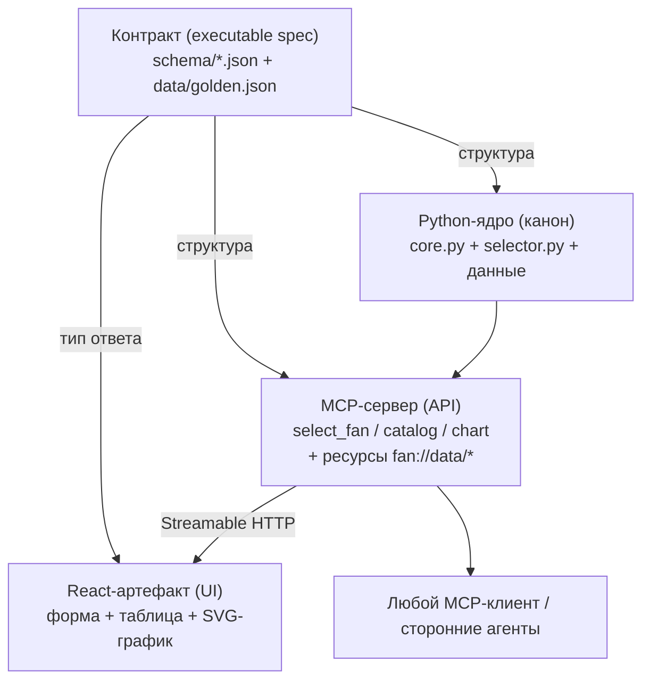

# Синтез: единая архитектура «ядро → API → UI» (MCP + React-артефакт)

Статус: **реализовано** (плагин DSH; см. корневой [README](../../README.md)). Исправленная версия после коррекции
«артефакт на React, а не на Rust». Сводит [MCP.md](MCP.md) (бизнес-логика как MCP
вместо навыка) и [ARTIFACT_REACT.md](ARTIFACT_REACT.md) (ввод/вывод как
интерактивный React-артефакт вместо чата) в единое решение.

---

## 1. Общий тезис двух анализов

Оба документа отвечают на один вопрос с двух сторон:

> **как убрать LLM-диалог из цепочки «задача → расчёт → ответ»?**

- **MCP** убирает диалог из *интерфейса вызова* — вместо «агент знает шаги и сам
  вызывает Python» появляется типизированный API (`select_fan`/`catalog`/`chart`).
- **React-артефакт** убирает диалог из *интерфейса взаимодействия* — вместо «агент
  спрашивает Q/P и печатает таблицу в чат» появляется самодостаточный виджет.

Монолит **«навык + чат-диалог»** разбирается на три слоя:

```
         навык + чат-диалог  (сейчас, монолит)
                     │  декомпозиция
     ┌───────────────┼──────────────────┐
     ▼               ▼                  ▼
   ЯДРО            API-шов            UI-шов
 расчёт        (машиночитаемый)    (человекочитаемый)
 core.py        MCP-сервер          React-артефакт
                docs/MCP.md          docs/ARTIFACT_REACT.md
```

**MCP и артефакт — не два проекта, а два адаптера одного шва.**

---

## 2. Что у них общего

| Общий элемент | MCP.md | ARTIFACT_REACT.md |
|---------------|--------|-------------------|
| Ядро не меняется | Python-ядро остаётся каноном | Python-ядро остаётся каноном (React — только UI) |
| Контракт | `schema/*.json` → `inputSchema` | `schema/*.json` → модель формы и тип ответа |
| Данные | `data/*.json` → ресурсы `fan://data/*` | те же данные приходят через API/ресурсы |
| Golden-числа | smoke-тест через MCP-клиент | smoke-тест рендера через API |
| Блокер | умеет ли DSH быть MCP-клиентом | умеет ли DSH рендерить HTML/JS-виджет |

Два «разных» блокера — **один и тот же**: насколько расширяема поверхность DSH за
пределами навыков (раздел 7).

---

## 3. Главный вывод после коррекции (Rust → React)

В ошибочном Rust→WASM-варианте синтез вскрывал мучительный вопрос **«сколько
реализаций ядра»** и предлагал миграцию на единое Rust-ядро. Коррекция на React
**снимает этот вопрос целиком**:

- React — только UI, расчёт остаётся в Python-ядре;
- значит ядро **одно** (Python), реализация **одна**, паритетность **не нужна**;
- MCP-сервер и React-артефакт — два **тонких адаптера** одного и того же
  `run_selection`.

Вместо трёх конкурирующих конечных состояний остаётся одно осмысленное:

> **Python-ядро (канон) + MCP-сервер (API) + React-артефакт (UI).**

Альтернативы для UI (Pyodide — самодостаточный офлайн; TS-порт — не рекомендован)
описаны в `ARTIFACT_REACT.md`, раздел 5; на основной путь они не влияют.

---

## 4. Контракт = executable spec

Оба анализа независимо показали, что `schema/*.json` + golden-числа — это уже
почти готовый **исполняемый контракт** домена. Синтез делает статус явным:

- **`schema/selection.schema.json` + `schema/result.schema.json`** — *структурный*
  контракт: это входной контракт ядра, `inputSchema` MCP-инструмента **и** модель
  формы + тип ответа React-артефакта. Один источник — три потребителя.
- **Golden-числа** (`ВР 280-46-6.3(1DN)-Y-X/750: ΔP=47.56, η=0.6292, N=2846.61`) —
  *семантический/числовой* контракт, по которому проверяются все адаптеры.

Предложение — поднять до **спеки по примеру**: экспортировать ответы ядра на сетке
(Q, P) в `data/golden.json` и сделать её единственной точкой проверки:

- Python golden-тесты — читают `golden.json`;
- MCP smoke-тест — сверяет сводку с `golden.json`;
- React component-тест — сверяет, что виджет рендерит `result.schema.json` без
  искажения чисел.

Тогда API и UI проверяются **тем же швом, что и ядро** (интерфейс — это тестовая
поверхность), а порт ядра и риск расхождения реализаций исключены по построению.

---

## 5. Рекомендуемая целевая архитектура



Тонкие адаптеры `API` и `UI` сидят на одном шве (`run_selection`). Если браузерный
MCP окажется тяжёлым, `UI` переключается на тонкий JSON-эндпоинт поверх того же
ядра — контракт при этом не меняется.

---

## 6. Единый роадмап

| # | Шаг | Источник |
|---|-----|----------|
| 1 | Поднять контракт: `data/golden.json` по сетке (Q, P) + схемы как единый источник | синтез |
| 2 | MCP-сервер поверх Python-ядра (`select_fan`/`catalog`/`chart` + ресурсы) + smoke-тест | MCP.md фаза 1 |
| 3 | React-артефакт: форма + таблица + SVG-график, данные из `select_fan`/`fan_chart` | ARTIFACT_REACT фаза 2 |
| 4 | Навык → тонкий указатель «используй MCP/артефакт» (фолбэк оставить) | MCP.md уровень 2 |
| 5 | Встраивание в DSH (MCP-клиент + рендер виджета) — после проверки расширяемости | оба doc'а |
| (опц.) | Офлайн-вариант Pyodide, если потребуется работа без сервера | ARTIFACT_REACT фаза 4 |

Шаги 2 и 3 независимы после шага 1: MCP-сервер можно показать клиентам, пока
React-виджет ещё в работе.

---

## 7. Консолидированный реестр рисков и открытых вопросов

### Риски

| Риск | Откуда | Как закрывается |
|------|--------|-----------------|
| Python 3.11+ у SDK MCP при `requires-python >=3.10` | MCP.md | поднять минимум или зафиксировать версию SDK |
| Браузерный MCP тяжёл (CORS/сессии/auth) | ARTIFACT_REACT | фолбэк — тонкий JSON-эндпоинт поверх того же ядра |
| Регрессия качества рендера | ARTIFACT_REACT | `result.schema.json` как тип; component-тест рендера |

> Числовая паритетность и дрейф реализаций **вычеркнуты** из рисков: ядро одно
> (Python), порта нет.

### Открытые вопросы (один блокер, два проявления)

1. **Расширяемость DSH.** Умеет ли харнесс (а) быть MCP-клиентом (stdio/HTTP),
   (б) рендерить HTML/JS-виджет в панели, (в) дать виджету сетевой доступ к
   MCP-серверу. Это **один вопрос**; он блокирует шаг 5 и полную замену навыка.

2. **Механизм артефакта.** Если DSH-артефакты — React/TSX (по образцу Claude
   Artifacts), подтвердить совместимость билда с Vite-шеллом харнесса.

3. **Судьба `config.py`.** Для UI достаточно `validation.*` + `top_n`; живой конфиг
   не обязателен.

4. **`t_air`.** Принимается, но не используется ядром — не смешивать с портом
   (порт теперь не нужен; вопрос остаётся как отдельная фича).

---

## 8. Итог одной строкой

MCP и React-артефакт — **два тонких адаптера одного Python-ядра**, а не два
проекта; коррекция «Rust → React» убирает единственную дилемму синтеза (сколько
реализаций ядра) и оставляет простую целевую схему: **Python-ядро + MCP-сервер +
React-артефакт**, связанных контрактом `schema/*.json + data/golden.json`.
