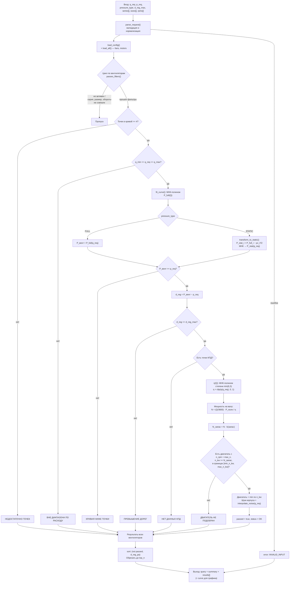

# Расчётная логика fan-selector

Документ описывает **как именно считается подбор радиального вентилятора** в этом
проекте: от входной рабочей точки (расход + давление) до марки электродвигателя.
Здесь есть схема потока расчёта, формулы, контракты данных и пошаговые
инструкции, как расширять справочники.

> Все числа в примерах получены прогоном текущего ядра — их можно воспроизвести
> командой из раздела [«Проверка»](#9-проверка-расчёта).

---

## 1. Что делает программа

Программа отвечает на один вопрос:

> «Заказчику нужен расход *Q* м³/ч при давлении *P* Па. Какой вентилятор серий
> **ВР 86-77** / **ВР 280-46** и какой электродвигатель подойдут?»

Для каждого вентилятора из справочника она:

1. отбрасывает те, что не покрывают требуемый расход;
2. строит аэродинамическую характеристику `P(Q)` и находит давление в рабочей точке;
3. проверяет, что кривая «перекрывает» требуемую точку с запасом;
4. считает **дорегулирование** — на сколько Па вентилятор «передавливает»;
5. находит **КПД** η в рабочей точке;
6. считает **мощность на валу**, умножает на коэффициент запаса;
7. подбирает **электродвигатель** минимальной достаточной мощности;
8. при наличии данных — оценивает **шум корпуса**.

Всё, что проходит все проверки, сортируется по дорегулированию (меньше — лучше).

Расчёт реализован как **чистое ядро** — JSON на входе, JSON на выходе, без
интерфейса. Ввод-вывод и визуализацию берёт на себя агент/харнесс
(см. `.dsh/skills/fan-selector/SKILL.md`).

---

## 2. Карта модулей

```
select-radial-fan/
├── data/                      СПРАВОЧНИКИ (данные, а не код)
│   ├── impellers.json         рабочие колёса: точки P(Q), точки η(Q), площадь выхода
│   ├── fans.json              карточки вентиляторов: серия, обороты, границы двигателя, шум
│   ├── motors.json            электродвигатели: марка, кВт, об/мин
│   └── config.json            ρ воздуха, степень полинома, таблица запасов, границы валидации
│
├── fan_selector/
│   ├── select.py              АДАПТЕР: dict -> dict, единственная точка входа
│   ├── repositories.py        загрузка JSON -> доменные модели (+ lru_cache)
│   ├── config.py              загрузка и валидация config.json (fail-fast)
│   ├── selector.py            ОРКЕСТРАТОР: фильтры + перебор + сортировка
│   ├── core.py                РАСЧЁТНОЕ ЯДРО — чистые функции, без I/O
│   └── models.py              доменные модели (dataclass)
│
├── schema/                    JSON Schema входа и выхода
└── tests/test_golden.py       golden-тесты: фиксируют числа
```

**Ключевое разделение:**

| Слой | Модули | Что меняется при расширении |
|------|--------|-----------------------------|
| Данные | `data/*.json` | **Правится свободно** — код не трогаем |
| Константы расчёта | `data/config.json` | Правится без кода, кроме добавления новых *полей* модели |
| Расчётная логика | `core.py` | Меняется только при изменении **метода** расчёта |
| Контракт снаружи | `select.py`, `schema/` | Меняется при изменении **входных/выходных полей** |

---

## 3. Схема логики расчёта



### Порядок проверок не случаен

Проверки идут **от дешёвых к дорогим** и образуют «воронку». Отчёт всегда
показывает *первую* сработавшую причину отказа — это осознанное решение:
пользователю важно узнать главное препятствие, а не весь список.

| # | Проверка | Статус отказа | Что означает |
|---|----------|---------------|--------------|
| 1 | `len(q_points) >= 4` | `НЕДОСТАТОЧНО ТОЧЕК` | Кривую нельзя построить |
| 2 | `q_min ≤ Q ≤ q_max` | `ВНЕ ДИАПАЗОНА ПО РАСХОДУ` | Рабочая зона не покрывает расход |
| 3 | `P_вент(Q) ≥ p_req` | `КРИВАЯ НИЖЕ ТОЧКИ` | Вентилятор не создаёт нужное давление |
| 4 | `Δрег ≤ d_reg_max` | `ПРЕВЫШЕНИЕ ДОРЕГ` | Слишком сильно «передавливает» — неэффективен |
| 5 | есть `eff_points` | `НЕТ ДАННЫХ КПД` | Невозможно посчитать мощность |
| 6 | найден двигатель | `ДВИГАТЕЛЬ НЕ ПОДОБРАН` | Нет двигателя нужных оборотов/мощности |

---

## 4. Математика расчёта

### 4.1. Аппроксимация характеристики — метод наименьших квадратов

Исходные данные — **табличные точки** из каталога (`q_points`, `p_points`).
Связная формула отсутствует, поэтому строится аппроксимирующий полином:

```python
def fit_curve(q, p, degree=6):
    deg = min(degree, len(q) - 1)          # степень ≤ (число точек − 1)
    return np.poly1d(np.polyfit(q, p, deg))
```

`np.polyfit` — это МНК-аппроксимация (прямой аналог функции `ЛИНЕЙН` в Excel).
После построения `poly1d` позволяет получить значение в любой точке:
`P = poly(Q)`.

**Важная деталь:** степень полинома автоматически понижается, если точек мало.
Сейчас в справочнике данные гетерогенны: у ряда колёс по **10 точек** P(Q)
(степень 6), у части — по **6 точек** (степень понижается до 5 с предупреждением
`UserWarning: Точек (6) меньше, чем нужно для степени 6; понижаю степень до 5`).
Это не ошибка — предупреждение защищает от переобучения (мало точек на много
коэффициентов дают нулевую невязку, но неадекватное поведение между точками).

*Где:* `core.py::fit_curve` · *Параметр:* `config.json::poly_degree`

### 4.2. Полное и статическое давление

Вентилятор создаёт **полное давление**, которое складывается из статического
(«полезного», толкающего воздух по сети) и динамического (кинетическая энергия
потока на выходе):

```
P_полн = P_стат + P_дин
```

Динамическое давление считается по площади выходного сечения `F`:

```python
v = (Q / 3600) / F          # скорость на выходе, м/с
P_дин = ρ · v² / 2          # Па
```

**Как это влияет на подбор.** Пользователь часто задаёт давление в сети, то есть
**статическое**. Если сравнивать его напрямую с каталожной кривой полного
давления — вентилятор ошибочно «пройдёт» отбор. Поэтому при
`pressure_type = STATIC` характеристика пересчитывается **по точкам**:

```python
P_стат_i = P_полн_i − ρ · v_i² / 2,   где v_i = Q_i / (3600 · F)
```

Пересчёт делается до аппроксимации, а не после — иначе полином строился бы по
точкам, которым соответствует разное динамическое давление, и форма кривой
искажалась бы.

**Мощность всегда считается по полному давлению** — двигатель вращает вал,
преодолевая полный напор, а не только его статическую часть:

```python
if pressure_type == STATIC:
    P_полн = p_req + P_дин(q_req)     # восстановить полное из статического
else:
    P_полн = P_вент(q_req)
```

*Где:* `core.py::dynamic_pressure`, `core.py::transform_to_static` ·
*Параметр:* `config.json::rho_air = 1.2 кг/м³`

### 4.3. Дорегулирование

Вентилятор почти никогда не даёт ровно требуемое давление. Разница —
**дорегулирование**: на сколько Па его нужно «придушить» дросселем, заслонкой
или изменением частоты вращения:

```
Δрег = P_вент(Q_треб) − P_треб     [Па]
```

В два раза большее давление — это примерно в **8 раз** большая мощность при
дросселировании (кубическая зависимость `N ~ P^1.5` на регулировочной
характеристике). Поэтому:

* `Δрег = 0` — идеально, вентилятор работает точно в точке;
* `Δрег ≤ d_reg_max` (= 1500 Па) — допустимо;
* `Δрег > d_reg_max` — вариант отбрасывается как энергетически невыгодный.

Именно по `Δрег` и сортируются прошедшие результаты: **меньше — лучше**.

*Где:* `core.py::compute_one` (шаг «Дорегулирование») · *Параметр:* `d_reg_max`

### 4.4. КПД в рабочей точке

КПД задан табличными точками `eff_points` (доли от 0 до 1). Как и для
характеристики — строится полином МНК, но меньшей степени `min(poly_degree, 3)`:
кривая КПД имеет куполообразную форму, и высокая степень дала бы «осцилляции»
вблизи максимума.

```python
eta = clip(poly_eta(q_req), 0.0, 1.0)     # физически η ∈ (0, 1]
```

*Где:* `core.py::compute_one` (шаг «КПД в рабочей точке»)

### 4.5. Мощность на валу и коэффициент запаса

Полезная мощность потока:

```
N_полезн = Q[м³/с] · P_полн[Па] = (Q / 3600) · P_полн    [Вт]
```

Мощность на валу — с учётом полного КПД:

```
N_вала = N_полезн / η
```

Формула реализована с защитой от деления на ноль (`max(η, 0.01)`).

Далее применяется **коэффициент запаса**: двигатель не должен работать на
пределе. Таблица запасов задана лестницей по мощности на валу:

| N_вала, кВт | до 0.5 | до 1.0 | до 2.0 | до 5.0 | свыше |
|-------------|--------|--------|--------|--------|-------|
| Коэффициент | 1.50 | 1.30 | 1.20 | 1.15 | 1.10 |

```
N_расч = N_вала · k(N_вала)
```

Логика ступеней: у малых двигателей относительный запас должен быть больше
(меньше абсолютный «коридор» до следующей мощности, хуже охлаждение,
нестабильнее режим), у крупных — достаточен меньший процент.

*Где:* `core.py::safety_factor` · *Параметр:* `config.json::safety_table`

### 4.6. Подбор электродвигателя

Двигатель ищется по трём одновременным условиям:

| Условие | Смысл |
|---------|-------|
| `motor.n_rpm == fan.max_n` | Частота вращения двигателя = расчётная частота вентилятора |
| `fan.min_n_kw ≤ motor.n_kw ≤ fan.max_n_kw` | Мощность допустима для этой карточки вентилятора |
| `motor.n_kw ≥ N_расч` | Мощности хватает с учётом запаса |

Среди подходящих берётся **минимальный по `n_kw`** — принцип «самый дешёвый
достаточный», без переплаты за запас.

Именно поэтому `ВР 86-77-4-DN-1500` не может иметь двигатель мощнее 0.75 кВт, а
`ВР 86-77-4-DN-1000` — меньше 5.5 кВт: ограничения `min_n_kw`/`max_n_kw` — это
свойства *конструкции* конкретного вентилятора, а не общий справочник.

*Где:* `core.py::_select_motor`

### 4.7. Шум корпуса

Оценочно. Массив `noise_body` (дБ(А)) — 9 значений на кривую. Позиция
выбирается пропорционально положению расхода между `q_min` и `q_max`;
результат — **дискретное** значение из массива (не интерполяция):

```
t = (Q − Q_min) / (Q_max − Q_min)
idx = floor(t · (len(noise_body) − 1))
L = noise_body[idx]
```

Если данные отсутствуют — возвращается `0.0`. Если расход вне диапазона —
возвращается максимум массива (консервативная оценка).

*Где:* `core.py::_interpolate_noise` · *Поле карточки:* `fans.json::noise_body`

---

## 5. Таблица входов, выходов и параметров

### 5.1. Вход (`selection.schema.json`)

| Поле | Тип | Обязат. | По умолч. | Описание |
|------|-----|---------|-----------|----------|
| `q_req` | number | **да** | — | Требуемый расход, м³/ч |
| `p_req` | number | **да** | — | Требуемое давление, Па |
| `pressure_type` | string | нет | `FULL` | `FULL` (полное) / `STATIC` (статическое) |
| `d_reg_max` | number | нет | 1500.0 | Макс. допустимое дорегулирование, Па |
| `t_air` | number | нет | 20.0 | Температура воздуха, °C *(принимается, но в текущем расчёте не используется)* |
| `series` | string[] | нет | `[]` | Фильтр по сериям; пусто = все |
| `sizes` | number[] | нет | `[]` | Фильтр по диаметру колеса, м; пусто = все |
| `rpms` | integer[] | нет | `[]` | Фильтр по оборотам; пусто = все |

### 5.2. Выход (`result.schema.json`)

```
{ schema: "fan-result/v1",
  query:   { ...эхо входа... },
  summary: { total, passed, best_model, best_d_reg_pa },
  results: [ { model, series, size, max_n, status, passed,
               d_reg_pa, eta_req,
               n_shaft_with_margin_w, n_shaft_kw,
               motor: {name, n_kw, n_rpm} | null,
               noise_body_dba, q_work, p_work,
               curve: {q_points, p_points, q_eff, eff_points, q_min, q_max} } ] }
```

`curve` включён в каждый результат намеренно: он даёт харнессу всё нужное для
построения графика `P(Q)`, `η(Q)` и точек рабочего режима **без** повторного
обращения к файлам данных.

При некорректном входе возвращается `{"schema": ..., "error": {code, message}}`
— исключения наружу не выбрасываются никогда.

### 5.3. Параметры расчёта (`config.json`)

| Параметр | Значение | Влияние |
|----------|----------|---------|
| `rho_air` | 1.2 кг/м³ | Динамическое давление, пересчёт в статическое |
| `poly_degree` | 6 | Степень МНК-полинома характеристики |
| `min_points_for_degree` | 7 | Порог для предупреждения о понижении степени |
| `safety_table` | см. п. 4.5 | Таблица запасов мощности |
| `default_d_reg_max_pa` | 1500 Па | Дорегулирование по умолчанию |
| `top_n` | 10 | Максимум результатов в выдаче |
| `validation.q_min … p_max` | 100 … 10000 | Границы допустимого входа |

`config.json` валидируется по принципу **fail-fast**: при отсутствии файла,
неполных полях, неверных типах или нарушении диапазонов программа не
запускается и выдаёт понятную ошибку (`ConfigError`), а не считает «на мусоре».

---

## 6. Эталонный расчёт (проверяемый пример)

Вход:

```json
{"q_req": 7500, "p_req": 700, "pressure_type": "FULL"}
```

Проверено прогоном ядра — в выдаче 10 вариантов (top_n), **9 прошли**:

| Вентилятор | Δрег, Па | η | N_вала·k, Вт | Двигатель |
|------------|----------|---|--------------|-----------|
| **ВР 280-46-6.3(1DN)-Y-X/750** | **47.56** | 0.6292 | 2846.61 | **160S8** (7.5 кВт, 750 об/мин) |
| ВР 86-77-8(0.9DN)-Y-X/1000 | 125.09 | 0.7721 | 2560.32 | 112MB6 (4.0 кВт, 1000 об/мин) |
| ВР 86-77-5(1.05DN)-Y-X/1500 | 143.97 | 0.8317 | 2431.10 | 100S4 (3.0 кВт, 1500 об/мин) |
| ВР 86-77-4(0.9DN)-Y-X/3000 | 274.05 | 0.7184 | 3248.32 | 100S2 (4.0 кВт, 3000 об/мин) |
| ВР 280-46-5(1DN)-Y-X/1000 | 313.96 | 0.7080 | 3431.26 | 112MB6 (4.0 кВт, 1000 об/мин) |
| ВР 86-77-6.3(0.9DN)-Y-X/1500 | 386.82 | 0.8043 | 3237.38 | 132S4 (7.5 кВт, 1500 об/мин) |
| ВР 280-46-4(1DN)-Y-X/1500 | 738.80 | 0.6942 | 4965.48 | 132S4 (7.5 кВт, 1500 об/мин) |
| ВР 86-77-4(1DN)-Y-X/3000 | 1059.47 | 0.8233 | 5119.87 | 100L2 (5.5 кВт, 3000 об/мин) |
| ВР 86-77-4(1.05DN)-Y-X/3000 | 1457.73 | 0.8311 | 5949.54 | 112M2 (7.5 кВт, 3000 об/мин) |

Разбор результата:

* **Победитель** `ВР 280-46-6.3(1DN)-Y-X/750`: при 750 об/мин в точке 7500 м³/ч
  перекрывает 700 Па всего на **47.56 Па** — минимальное дорегулирование из всех.
* Следом идут варианты на 1000/1500/3000 об/мин с растущим дорегулированием —
  сортировка «меньше дорегулирование = лучше» отражает прямую связь с
  энергопотреблением.
* Остальные вентиляторы отсеиваются на проверках (диапазон расхода, двигатель,
  превышение дорегулирования); в выдачу попадают первые 10 (`top_n`), из них 9
  прошедших.

Эти числа — **регрессионный эталон**: `tests/test_golden.py` падает, если любое
из них изменится. Переработка интерфейса не должна менять результат расчёта.

---

## 7. Как расширять данные

Ядро устроено так, что **справочники расширяются без изменения кода**. Ниже —
пять уровней по возрастанию сложности.

### 7.1. Добавить вентилятор той же серии (самое частое)

Нужно **две записи**: в `fans.json` и `impellers.json`, связанные полем
`impeller_id`.

**Шаг 1.** В `data/impellers.json` — новое рабочее колесо. `q_points`,
`p_points`, `q_eff`, `eff_points` должны быть **одинаковой длины**:

```json
{
  "id": "wr86_77_8_1000",
  "series": "ВР 86-77",
  "diameter": 8.0,
  "nominal": "DN",
  "area_f_m2": 0.32,
  "q_min": 12000.0,
  "q_max": 30000.0,
  "q_points":  [12000.0, 15000.0, 18000.0, 21000.0, 26000.0, 30000.0],
  "p_points":  [1800.0, 1650.0, 1500.0, 1300.0, 950.0, 750.0],
  "q_eff":     [12000.0, 15000.0, 18000.0, 21000.0, 26000.0, 30000.0],
  "eff_points":[0.72, 0.80, 0.84, 0.82, 0.76, 0.68]
}
```

**Шаг 2.** В `data/fans.json` — карточка, ссылающаяся на этот `id`:

```json
{
  "type": "Радиальный",
  "series": "ВР 86-77",
  "model": "ВР 86-77-8-DN-1000",
  "max_n": 1000,
  "impeller_id": "wr86_77_8_1000",
  "min_n_kw": 7.5,
  "max_n_kw": 22.0,
  "noise_body": [88, 90, 91, 92, 90, 87, 82, 70, 93]
}
```

**Шаг 3.** Проверить: `q_min`/`q_max` колеса должны согласовываться с крайними
точками `q_points`; `area_f_m2` — реальная площадь выходного сечения; `max_n`
должен совпадать с `n_rpm` существующих двигателей в `motors.json`
(сейчас это 750 / 1000 / 1500 / 3000), иначе двигатель не подберётся никогда.

> Наименьшая длина точек — **4** (иначе `НЕДОСТАТОЧНО ТОЧЕК`). Рекомендуется
> **≥ 7 точек**, чтобы степень полинома 6 работала без понижения и без
> предупреждения.

### 7.2. Добавить электродвигатель

Новая запись в `data/motors.json`:

```json
{"name": "132M6", "n_kw": 7.5, "n_rpm": 1000}
```

Обязательны только `name`, `n_kw`, `n_rpm`. Остальные поля модели
(`i_nom`, `mass`, `i_start`, `m_max_m_nom`, `m_start_m_nom`) — справочные,
можно указать для полноты отчёта:

```json
{"name": "132M6", "n_kw": 7.5, "n_rpm": 1000, "i_nom": 15.4, "mass": 72.0, "i_start": 7.0}
```

Двигатель подхватится автоматически. Чтобы он стал доступен конкретному
вентилятору, проверьте диапазон `min_n_kw … max_n_kw` его карточки в
`fans.json` — двигатель вне этого диапазона не будет выбран, даже если
мощности хватает.

### 7.3. Добавить новую серию вентиляторов

Дополнительного кода **не требуется**: серия — это строковое поле в обоих
справочниках, а фильтр `series` сравнивает строки.

1. Добавьте колёса в `impellers.json` с `"series": "ВР 75-80"` (пример);
2. Добавьте карточки в `fans.json` с тем же значением `series`;
3. При желании обновите список опций в `.dsh/skills/fan-selector/SKILL.md`
   (шаг 3 «Серия») — это влияет только на подсказки агенту, не на расчёт.

### 7.4. Изменить параметры расчёта (без правки кода)

Всё в `data/config.json`:

| Хочу | Менять |
|------|--------|
| Другую плотность воздуха (например, `1.2` → `1.15` для 20 °C) | `rho_air` |
| Сгладить/уточнить аппроксимацию | `poly_degree` (допустимо 2–10) |
| Другую политику запаса мощности | `safety_table` |
| Другое дорегулирование по умолчанию | `default_d_reg_max_pa` |
| Больше вариантов в выдаче | `top_n` |
| Другие границы допустимого входа | `validation.*` |

Правила для `safety_table`: коэффициенты **> 1.0**, пороги строго
**по возрастанию**, последняя запись — `"max_power_kw": null` (catch-all).
При нарушении программа не запустится с внятной ошибкой.

Другие расположения данных задаются переменными окружения:

```bash
FAN_CONFIG_PATH=/path/config.json   # свой config.json
FAN_DATA_DIR=/path/data             # своя папка справочников
```

### 7.5. Что потребует изменения кода

| Расширение | Где править |
|------------|-------------|
| Новое **поле карточки** (например, `power_kw_rated`) | `models.py` (dataclass) + `select.py` (выдача) |
| Новый **фильтр** (например, по массе) | `selector.py::passes_filters` + `models.py::SelectionRequest` + `schema/selection.schema.json` |
| Новый **статус** отказа | `models.py::ResultStatus` + `core.py` + `schema/result.schema.json` |
| Другой **метод аппроксимации** (сплайн вместо МНК) | `core.py::fit_curve` — единственная точка |
| Учёт `t_air` (пересчёт плотности) | `core.py::compute_one` — сейчас `t_air` принимается, но не используется |
| Новый **критерий сортировки** | `selector.py::select_fans` (сейчас: `(not passed, d_reg_pa)`) |

### 7.6. Чек-лист валидации после расширения

```bash
cd select-radial-fan

# 1. Схемы и структура: ссылки impeller_id существуют?
python -c "from fan_selector.repositories import load_all; f,m = load_all(); \
  bad=[x.model for x in f if x.impeller is None]; print('broken refs:', bad)"

# 2. Длины массивов совпадают, точек >= 4?
python -c "from fan_selector.repositories import load_all; \
  f,_=load_all(); \
  print([(x.model,len(x.q_points),len(x.p_points),len(x.q_eff),len(x.eff_points)) \
  for x in f if not (len(x.q_points)==len(x.p_points)==len(x.q_eff)==len(x.eff_points)>=4)])"

# 3. Golden-тесты (эталонные числа не должны измениться)
python tests/test_golden.py

# 4. Прогон на реальной точке
python -X utf8 -m fan_selector --json <<< '{"q_req":7500,"p_req":700}'
```

Если golden-тесты упали **после добавления данных** — это ожидаемо и требует
осознанного решения: либо новые данные физически меняют результат (тогда
обновите эталон в `tests/test_golden.py` с обоснованием в коммите), либо
данные внесены с ошибкой.

---

## 8. Ограничения текущей модели

Честный список того, чего расчёт **не** делает — чтобы не было завышенных
ожиданий.

| Ограничение | Следствие |
|-------------|-----------|
| Одна частота вращения на карточку (`max_n`) | Вентилятор с ЧРП не моделируется |
| `t_air` принимается, но не применяется | Плотность всегда 1.2 кг/м³ |
| Нет пересчёта по законам подобия | Нельзя пересчитать характеристику с 1000 на 1200 об/мин |
| Шум — дискретная выборка | Оценка, не расчёт акустики |
| Нет учёта аэродинамики сети | Сопротивление сети не пересекается с кривой |
| КПД — фиксированные каталоговые точки | Не зависит от диаметра/оборотов |
| Фильтры — точное совпадение чисел | `sizes: [4]` не заменит `[4.0]` при float-сравнении |
| Сортировка только по `Δрег` | Не учитывает цену, массу, габариты |

Каждое ограничение соответствует одной строке в таблице п. 7.5 — это готовый
роадмап развития.

---

## 9. Проверка расчёта

```bash
cd select-radial-fan

# CLI: JSON на stdin, JSON на stdout
echo '{"q_req":7500,"p_req":700}' | python -X utf8 -m fan_selector --json

# Как функция
python -c "from fan_selector import run_selection; \
  print(run_selection({'q_req':7500,'p_req':700})['summary'])"

# Golden-тесты (5 проверок: эталон, второй вариант, невалидный вход,
# статическое давление, наличие curve)
python tests/test_golden.py
```

Ожидаемая сводка для эталонной точки:

```
{'total': 10, 'passed': 9, 'best_model': 'ВР 280-46-6.3(1DN)-Y-X/750', 'best_d_reg_pa': 47.56}
```

---

## 10. Ключевые проектные решения

| Решение | Причина |
|---------|---------|
| Ядро — чистые функции без I/O | Детерминированность, тестируемость, независимость от интерфейса |
| JSON-in / JSON-out | Любой рантайм может вызвать: CLI, subprocess, тест, навык |
| Данные вынесены в JSON | Расширение справочника не требует релиза кода |
| `config.json` с fail-fast валидацией | Ошибка конфигурации видна сразу, а не даёт тихо неверный результат |
| МНК-полином вместо аналитической модели | Каталоговые данные табличные; полином воспроизводит их форму |
| Пересчёт статического давления до аппроксимации | Иначе форма кривой искажается |
| Мощность всегда по полному давлению | Двигатель вращает вал против полного напора |
| Первая сработавшая причина отказа | Отчёт читаем: видно главное препятствие |
| Сортировка по минимальному дорегулированию | Прямая связь с энергопотреблением |
| Golden-тесты на числа | Гарантия, что рефакторинг не меняет качество расчёта |

---

## Лицензия

MIT — см. [LICENSE](../LICENSE).
